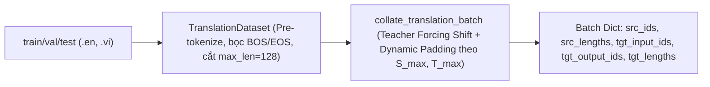

# Báo cáo PyTorch Dataset & DataLoader (Dynamic Padding) — Đề tài 8: Dịch máy Anh–Việt

> **Tài liệu lưu trữ:** Bản nháp kỹ thuật phục vụ soạn thảo Proposal (Tuần 1), Báo cáo cuối (Tuần 6) và ôn tập Vấn đáp cá nhân.  
> **Mã nguồn liên quan:** [`src/data/dataset.py`](../../src/data/dataset.py), [`src/data/tokenizer.py`](../../src/data/tokenizer.py), `data/processed/dataloader_stats.json`

---

## 1. Thiết kế Kiến trúc Dữ liệu Dùng chung (`src/data/dataset.py`)

Module [`src/data/dataset.py`](../../src/data/dataset.py) đóng vai trò cầu nối giữa **Bộ tách từ (`BaseTokenizer`)** và **hai kiến trúc mô hình học sâu (Seq2Seq LSTM + Attention và Transformer)**. Thiết kế tuân thủ nguyên tắc tách biệt hoàn toàn khỏi thuật toán tách từ cụ thể: chỉ giao tiếp qua hợp đồng `BaseTokenizer` (`encode`, `pad_id`, `bos_id`, `eos_id`), nên sau này có thể thay BPE bằng SentencePiece hoặc Word-level mà không cần sửa `DataLoader`.



### 1.1. Lớp `TranslationDataset`
- Đọc song song cặp tệp nguồn (`.en`) và đích (`.vi`), kiểm tra khớp số dòng và thống nhất `pad_id == 0`.
- Hỗ trợ cơ chế **`pre_tokenize=True`** (mặc định): mã hóa toàn bộ câu thành chuỗi `list[int]` (bọc `<bos>=2` ở đầu, `<eos>=3` ở cuối, giới hạn tối đa `max_len=128` token) ngay khi khởi tạo và lưu trên RAM. Với ~132k câu, dữ liệu số nguyên chỉ chiếm lượng RAM nhỏ nhưng loại bỏ hoàn toàn chi phí chạy lại BPE ở mỗi Epoch huấn luyện.
- Cung cấp `get_raw_pair(idx)` để lấy lại cặp văn bản gốc khi cần kiểm định hoặc phân tích lỗi dịch ở Tuần 5.

### 1.2. Dịch lệch 1 bước cho Teacher Forcing (`collate_translation_batch`)
Với mỗi câu đích sau mã hóa có dạng `tgt_ids = [<bos>, y_1, y_2, ..., y_m, <eos>]` (độ dài $L_{\text{tgt}} \le 128$), hàm `collate_translation_batch` tạo ra 2 chuỗi lệch nhau đúng 1 vị trí (đều có độ dài $L_{\text{tgt}} - 1$):
- **`tgt_input_ids = tgt_ids[:-1]`** $\rightarrow$ `[<bos>, y_1, y_2, ..., y_m]` *(đưa vào Decoder ở bước thời gian $t$)*.
- **`tgt_output_ids = tgt_ids[1:]`** $\rightarrow$ `[y_1, y_2, ..., y_m, <eos>]` *(làm nhãn đích để tính Cross-Entropy Loss dự đoán từ kế tiếp tại bước $t$)*.

### 1.3. Đệm động theo Batch (`Dynamic Padding`)
Thay vì đệm cứng toàn bộ dữ liệu lên độ dài tối đa (`128` cho nguồn, `127` cho đích), `collate_translation_batch` tính riêng giới hạn cho từng lô kích thước $B$:
- $S_{\max} = \max_{i=1..B} \text{len}(\text{src}_i) \le 128$
- $T_{\max} = \max_{i=1..B} \text{len}(\text{tgt\_in}_i) \le 127$

Sau đó chỉ chèn `PAD_ID = 0` vừa khít đến $(S_{\max}, T_{\max})$ của chính Batch đó. Hàm được đóng gói bằng `functools.partial` ở cấp module (thay vì `lambda`) để tương thích đa luồng (`num_workers > 0`) trên Windows/Linux.

---

## 2. Hợp đồng Đầu ra của mỗi Batch (`Batch Contract`)

Mỗi vòng lặp qua `DataLoader` (`batch_size = 64` mặc định) trả về một dictionary gồm 5 Tensor (`dtype=torch.int64`):

| Khóa (Key) | Kích thước (Shape) | Kiểu dữ liệu | Vai trò đối với Mô hình |
| :--- | :---: | :---: | :--- |
| `src_ids` | `(B, S_max)` | `torch.int64` | Đầu vào Encoder cho cả **LSTM** và **Transformer** |
| `src_lengths` | `(B,)` | `torch.int64` | Độ dài thực từng câu nguồn, phục vụ `pack_padded_sequence` trong **Seq2Seq LSTM** |
| `tgt_input_ids` | `(B, T_max)` | `torch.int64` | Đầu vào Decoder trong lúc huấn luyện (Teacher Forcing) |
| `tgt_output_ids` | `(B, T_max)` | `torch.int64` | Nhãn chuẩn để tính Loss (`ignore_index=0`) |
| `tgt_lengths` | `(B,)` | `torch.int64` | Độ dài thực của chuỗi đích sau dịch lệch (dùng thống kê token loss thực tế) |

---

## 3. Kiểm chứng Thực nghiệm & Hiệu quả Dynamic Padding (`IWSLT'15 En-Vi`)

Kết quả chạy kiểm thử toàn bộ 3 tập với `batch_size = 64`, `max_len = 128`, `seed = 42` trích xuất từ `data/processed/dataloader_stats.json`:

### 3.1. Kiểm tra mẫu Batch đầu tiên trên tập `val` (`tst2012`)
- **Kích thước Tensor trả về:**
  - `src_ids`: `(64, 103)` | `src_lengths`: `(64,)`
  - `tgt_input_ids`: `(64, 127)` | `tgt_output_ids`: `(64, 127)` | `tgt_lengths`: `(64,)`
- **Kiểm tra ràng buộc cấu trúc (`_verify_batch_invariants`) qua 100% các Batch (2,110 batches trên cả 3 tập):**
  - Mọi câu trong `src_ids` và `tgt_input_ids` đều bắt đầu bằng `<bos>` (`2`).
  - Mọi câu trong `src_ids` và `tgt_output_ids` đều kết thúc phần nội dung thực bằng `<eos>` (`3`).
  - Mọi phần tử nội dung dịch lệch 1 bước giữa `tgt_input_ids[:, 1:]` và `tgt_output_ids[:, :-1]` khớp tuyệt đối.
  - Tổng số phần tử khác `PAD_ID = 0` khớp 100% với `src_lengths` và `tgt_lengths`.
- **Quan sát thực tế ở mẫu `[0]` của tập `val`:** Câu tiếng Việt đầu tiên trong `val.vi` là câu duy nhất đạt 129 token BPE trong tập `val`, đã được cắt gọn đúng 128 token (gồm `<bos>` và `<eos>`), sau Teacher Forcing shift có độ dài `tgt_lengths[0] = 127`.

### 3.2. Hiệu quả tiết kiệm tính toán của Dynamic Padding (so với Static Padding 128 / 127)

| Tập dữ liệu | Số câu | Số Batch (`B=64`) | `S_max` Batch (Mean / Median / Max) | `T_max` Batch (Mean / Median / Max) | Mật độ token thực Dynamic (Src / Tgt) | Mật độ token thực Static (Src / Tgt) | Số ô tính toán tiết kiệm được (Src / Tgt) |
| :--- | ---: | ---: | :---: | :---: | :---: | :---: | :---: |
| **Train** (`shuffle=True`) | 132,160 | 2,065 | 86.45 / 83.0 / 128 | 94.02 / 92.0 / 127 | 29.12% / 28.18% | 19.67% / 20.86% | **32.46%** / **25.97%** |
| **Val** (`shuffle=False`) | 1,553 | 25 | 66.16 / 62.0 / 103 | 73.52 / 68.0 / 127 | 33.30% / 31.94% | 17.37% / 18.59% | **47.84%** / **41.81%** |
| **Test** (`shuffle=False`) | 1,268 | 20 | 74.55 / 72.5 / 112 | 83.35 / 78.5 / 126 | 34.88% / 33.82% | 20.31% / 22.23% | **41.78%** / **34.26%** |

**Nhận xét kỹ thuật:**
1. **Tiết kiệm đáng kể dung lượng và phép nhân ma trận:** Ngay cả khi trộn ngẫu nhiên hoàn toàn trên tập `train` (`shuffle=True`), Dynamic Padding giúp giảm trực tiếp **32.46%** số ô tính toán ở Encoder và **25.97%** ở Decoder so với đệm tĩnh (tiết kiệm **~5.49 triệu ô** ở `src` và **~4.36 triệu ô** ở `tgt` mỗi Epoch). Trên `val` và `test`, mức tiết kiệm đạt **34%–48%**.
2. **Hướng tối ưu nâng cao tiềm năng (Giai đoạn mở rộng):** Vì một Batch ngẫu nhiên 64 câu trên tập `train` thường dính ít nhất 1 câu dài (~83–94 token), mật độ token thực đạt ~28%–29%. Ở giai đoạn tối ưu sau này, có thể khảo sát thêm chiến lược **Length Bucketing** (gom các câu có độ dài xấp xỉ nhau vào cùng Batch) để đẩy mật độ token thực lên trên 80%.

---

## 4. Hướng dẫn Sử dụng Nhanh & Chạy Kiểm thử

- **Sử dụng trong code huấn luyện (`train.py`):**
  ```python
  from src.data.tokenizer import load_tokenizer
  from src.data.dataset import build_dataloaders

  src_tok = load_tokenizer("data/tokenizer/bpe_en.json")
  tgt_tok = load_tokenizer("data/tokenizer/bpe_vi.json")
  loaders = build_dataloaders("data/processed", src_tok, tgt_tok, batch_size=64, max_len=128)
  ```
- **Chạy kiểm thử độc lập từ dòng lệnh:**
  ```bash
  python -m src.data.dataset --batch-size 64 --max-len 128
  ```
  Lệnh trên sẽ kiểm tra toàn bộ ràng buộc Tensor qua cả 3 tập dữ liệu và xuất thống kê chi tiết tại `data/processed/dataloader_stats.json`.
