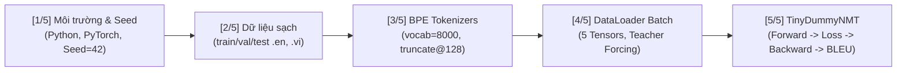

# Báo cáo Chạy thử Môi trường & Kiểm định Pipeline Giai đoạn 1 — Đề tài 8: Dịch máy Anh–Việt

> **Tài liệu lưu trữ:** Bản nháp kỹ thuật tổng kết Mảng 1 (Dữ liệu, Tokenizer, DataLoader, Đánh giá BLEU & Môi trường), phục vụ soạn thảo Proposal (Tuần 1), Báo cáo cuối (Tuần 6) và Vấn đáp.  
> **Mã nguồn liên quan:** [`requirements.txt`](../../requirements.txt), [`tests/test_phase1_pipeline.py`](../../tests/test_phase1_pipeline.py), `data/processed/phase1_smoke_test.json`

---

## 1. Cấu hình Môi trường & Thư viện (`requirements.txt`)

File [`requirements.txt`](../../requirements.txt) được thiết lập ở thư mục gốc dự án để cố định phiên bản tối thiểu cho các thư viện cốt lõi, giúp mọi thành viên và hội đồng chấm điểm tái tạo môi trường bằng `pip install -r requirements.txt`.

Kiểm tra thực tế trên máy phát triển (`Windows-11-10.0.26300-SP0`):

| Thư viện | Mục đích sử dụng trong dự án | Yêu cầu (`requirements.txt`) | Phiên bản thực tế đã kiểm thử |
| :--- | :--- | :--- | :---: |
| **`python`** | Ngôn ngữ lập trình nền tảng | `>=3.10` | `3.13.5` |
| **`torch`** | Xây dựng & huấn luyện Seq2Seq LSTM, Transformer | `>=2.0.0` | `2.14.1+cpu` |
| **`tokenizers`** | Huấn luyện & chạy bộ tách từ BPE | `>=0.20.0` | `0.23.3` |
| **`sacrebleu`** | Tính chỉ số BLEU-4 chuẩn WMT/ACL kèm signature | `==2.6.0` | `2.6.0` |
| **`numpy`** | Xử lý mảng số & cố định seed ngẫu nhiên | `>=1.24.0` | `2.4.6` |
| **`pyyaml`** | Đọc file cấu hình siêu tham số (`configs/*.yaml`) | `>=6.0` | `6.0.3` |
| **`wandb`** | Theo dõi log huấn luyện thực nghiệm (tùy chọn tắt qua `--no-wandb` khi test CPU) | `>=0.16.0` | *(cài ở env GPU)* |
| **`matplotlib`** | Vẽ đồ thị Loss, BLEU & Attention Heatmap (Tuần 5) | `>=3.7.0` | `3.10.0` |
| **`tqdm`** | Thanh tiến trình huấn luyện & đánh giá | `>=4.65.0` | `4.67.1` |
| **`pytest`** | Chạy bộ kiểm thử tự động (`tests/*.py`) | `>=7.4.0` | `8.3.4` |

*(Trong [`requirements.txt`](../../requirements.txt) có kèm dòng tùy chọn `# sentencepiece>=0.1.99` phục vụ thí nghiệm mở rộng `SentencePieceTokenizer`; module `src/data/tokenizer.py` bọc import tùy chọn nên không bắt buộc cài nếu chỉ dùng BPE).*

> [!NOTE]
> **Ghi chú phần cứng (`device = cpu`):** Môi trường cục bộ đang chạy `PyTorch 2.14.1+cpu` (`cuda_available = False`). Thiết lập này chạy rất nhanh và ổn định cho việc viết code, debug kiến trúc tensor và chạy kiểm thử tích hợp; khi bước sang huấn luyện toàn bộ 131,942 câu qua nhiều Epoch ở Tuần 2–4, chỉ cần giữ nguyên code (do mọi tensor đã dùng `.to(device)`) và chạy trên máy/GPU có CUDA để tăng tốc huấn luyện.

---

## 2. Kiến trúc Kiểm định Khép kín 5 Mắt xích (`tests/test_phase1_pipeline.py`)

Thay vì kiểm tra rời rạc từng file, [`tests/test_phase1_pipeline.py`](../../tests/test_phase1_pipeline.py) thực hiện một **Smoke Test khép kín từ đầu đến cuối** (tương thích cả lệnh `python -m tests.test_phase1_pipeline` lẫn `pytest`):



---

## 3. Kết quả Kiểm định Thực nghiệm Toàn bộ 5 Mắt xích

Kết quả ghi nhận từ lệnh `python -m tests.test_phase1_pipeline` (trích xuất tại `data/processed/phase1_smoke_test.json`) và `pytest tests/test_phase1_pipeline.py`:

| Mắt xích | Nội dung kiểm chứng | Kết quả thực tế ghi nhận | Trạng thái |
| :---: | :--- | :--- | :---: |
| **1/5** | Môi trường, thư viện & tính tái lập hạt giống ngẫu nhiên (`seed=42`) | Rút 2 tensor ngẫu nhiên cùng `seed=42` khớp tuyệt đối 100%; các thư viện cốt lõi (`torch`, `tokenizers`, `sacrebleu`, `numpy`) sẵn sàng | **PASS** |
| **2/5** | Toàn vẹn dữ liệu đã tiền xử lý trong `data/processed/` | `train`: `131,942` cặp \| `val`: `1,553` cặp \| `test`: `1,268` cặp; 0 dòng rỗng | **PASS** |
| **3/5** | Hợp đồng `BaseTokenizer` (`bpe_en.json`, `bpe_vi.json`) | `vocab_size = 8,000 / 8,000`; `pad=0, unk=1, bos=2, eos=3`; roundtrip 100%; cắt câu 200+ từ về đúng `128` giữ nguyên `<bos>`/`<eos>` | **PASS** |
| **4/5** | `TranslationDataset` & `DataLoader` (`batch_size=64`) trên tập `val` | `src_ids`: `(64, 103)` \| `tgt_input_ids` & `tgt_output_ids`: `(64, 127)` \| `dtype = torch.int64`; thỏa 100% bất biến Teacher Forcing | **PASS** |
| **5/5** | Chu trình học sâu `TinyDummyNMT` (`776,000` tham số) + `SacreBLEU` | • `logits`: `(64, 127, 8000)`<br/>• `Loss` khởi tạo ngẫu nhiên: **`9.1236`** *(xấp xỉ giá trị lý thuyết $\ln(8000) \approx 8.9872$)*<br/>• Sau `loss.backward()` (`grad_l2_norm = 0.2726`, không `NaN/Inf`) + `optimizer.step()` (Adam, `lr=0.01`), `Loss` giảm xuống **`8.8805`**<br/>• `decode_and_compute_bleu`: Dummy trước khi học đạt `0.01`, Oracle Batch đạt **`99.93`** | **PASS** |

Kiểm thử qua bộ chạy chuẩn `pytest`:
- `pytest tests/test_phase1_pipeline.py` $\rightarrow$ **`1 passed`**.

---

## 4. Kết luận Kết thúc Giai đoạn 1 (Mảng 1)

Với việc vượt qua toàn bộ 5 mắt xích kiểm định khép kín, **Mảng 1 (Dữ liệu, Tokenizer, DataLoader, Đánh giá BLEU & Môi trường)** đã hoàn thiện 100%:
1. Chuẩn dữ liệu song ngữ `IWSLT'15 En-Vi` đã sạch và thống nhất kích thước (`131,942 / 1,553 / 1,268`).
2. Giao diện `BaseTokenizer` (`BPE 8000`, `max_len=128`) đã đóng gói gọn gàng, hỗ trợ sẵn `SentencePieceTokenizer` tùy chọn và dễ dàng mở rộng thêm Word-level ở giai đoạn sau.
3. `DataLoader` trả về hợp đồng 5 Tensor chuẩn (`src_ids`, `src_lengths`, `tgt_input_ids`, `tgt_output_ids`, `tgt_lengths`) dùng chung cho cả Seq2Seq LSTM và Transformer.
4. Module `sacrebleu` đã kiểm định toán học xong.
5. Toàn bộ ống dẫn *Data $\rightarrow$ Tensor $\rightarrow$ Loss $\rightarrow$ Gradient $\rightarrow$ BLEU* đã thông suốt, sẵn sàng bước sang **Giai đoạn 2: Xây dựng Baseline Seq2Seq LSTM + Attention**.

---

## 5. Lệnh chạy lại Kiểm thử

```bash
# Chạy kèm xuất báo cáo chi tiết
python -m tests.test_phase1_pipeline

# Hoặc chạy qua pytest
pytest tests/test_phase1_pipeline.py
```
