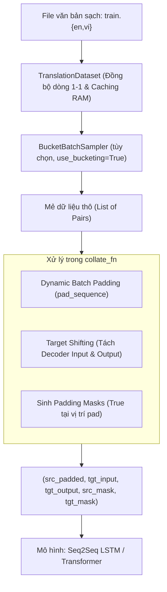

# Báo cáo Đường ống Nạp Dữ liệu (Dataset & DataLoader) — Đề tài 8: Dịch máy Anh–Việt (IWSLT'15 En–Vi)

> **Tài liệu lưu trữ:** Bản nháp kỹ thuật phục vụ soạn thảo Proposal (Tuần 1), Báo cáo cuối (Tuần 6) và ôn tập Vấn đáp cá nhân.  
> **Mã nguồn liên quan:** [`src/data/dataset.py`](../../src/data/dataset.py), [`src/data/tokenizer.py`](../../src/data/tokenizer.py), [`tests/test_data_pipeline.py`](../../tests/test_data_pipeline.py)

---

## 1. Tổng quan Kiến trúc Đường ống Nạp Dữ liệu

File [`src/data/dataset.py`](file:///home/bqhwng/dich-may-Anh-Viet/src/data/dataset.py) đóng vai trò là "cầu nối" hiệu năng cao giữa dữ liệu văn bản sạch đã tiền xử lý (`data/processed/`) và các mô hình học sâu PyTorch (Seq2Seq LSTM Attention & Transformer).



---

## 2. Chi tiết các Thành phần Kỹ thuật (`src/data/dataset.py`)

### 2.1. Lớp Dữ liệu Song ngữ: `TranslationDataset`
1. **Kiểm tra tính toàn vẹn số dòng (Strict Line Count Validation):**
   - Trước khi nạp dữ liệu, lớp xác minh `len(src_lines) == len(tgt_lines)`. Nếu phát hiện số dòng nguồn và đích lệch nhau, hệ thống lập tức báo lỗi `ValueError` thay vì âm thầm cắt bớt dữ liệu bằng `zip()`.
2. **Bảo toàn căn chỉnh dòng 1-1 (No Silent Drop):**
   - Không áp dụng bất kỳ bộ lọc làm rơi dòng nào trong Dataset. Mọi cặp dòng đều được giữ nguyên vẹn vị trí chỉ số (`idx`). Điều này đặc biệt tối quan trọng với tập `val` (1,553 dòng) và `test` (1,268 dòng) để bảo đảm câu dự đoán của mô hình luôn đối sánh chuẩn xác dòng-với-dòng với file nhãn tham chiếu khi chấm điểm BLEU.
3. **Thuật toán Truncation bảo toàn token `<eos>`:**
   - Trong các hệ thống dịch máy, nếu câu quá dài bị cắt gọt thô bạo bằng `tokens[:max_len]`, token kết thúc `<eos>` sẽ bị rơi mất. Khi đó mô hình học sai rằng câu không bao giờ kết thúc, dẫn đến hiện tượng lặp từ vô tận khi suy luận (Inference).
   - `TranslationDataset` áp dụng kỹ thuật gọt thông minh:
     ```python
     # Luôn dành 2 vị trí cố định cho <sos> ở đầu và <eos> ở cuối
     if len(raw_ids) > self.max_len - 2:
         raw_ids = raw_ids[: self.max_len - 2]
     final_ids = [tok.sos_id] + raw_ids + [tok.eos_id]
     ```
     Đảm bảo: Độ dài $\le \text{max\_len}$, `final_ids[0] == <sos>`, và `final_ids[-1] == <eos>`.
4. **Cơ chế Caching Tokenized vào RAM (`cache_tokenized=True`):**
   - Thay vì phải gọi bộ tách từ BPE hàng trăm nghìn lần mỗi epoch, `TranslationDataset` chuyển hóa toàn bộ văn bản sang Tensor số nguyên ngay trong pha khởi tạo (`__init__`).
   - Với 131,942 cặp câu (trung bình `25.58` token EN + `27.44` token VI, kiểu `int64`), riêng dữ liệu token chiếm khoảng **~53 MB RAM**, chưa tính overhead của ~264 nghìn đối tượng Tensor. Đổi lại, không phải tokenize lại mỗi epoch (mức tăng tốc thực tế chưa được đo).

---

### 2.2. Hàm Gộp Mẻ Động & Dịch chuyển Mục tiêu: `collate_fn`

#### A. Kỹ thuật Padding Động theo Mẻ (Dynamic Batch Padding)
- **Vấn đề của Padding cố định:** Nếu pad toàn bộ dữ liệu về độ dài cố định 160 tokens, một batch gồm các câu dài 15–20 tokens sẽ chứa tới **~88–90% là token `<pad>` vô nghĩa**, gây lãng phí bộ nhớ GPU và phép tính Self-Attention.
- **Giải pháp Padding động:** Hàm `collate_fn` sử dụng `torch.nn.utils.rnn.pad_sequence(..., batch_first=True, padding_value=pad_id)`, với `pad_id` lấy từ tokenizer (`src_tokenizer.pad_id`, hiện bằng `0`). Mỗi batch chỉ được pad đến độ dài của **câu dài nhất trong chính batch đó** ($L_{\text{batch}} \le 160$), giảm thiểu tối đa chi phí tính toán.
- `get_dataloader` truyền `collate_fn` qua `functools.partial` (thay vì `lambda`) để DataLoader pickle được khi chạy `num_workers > 0`.

#### B. Kỹ thuật Dịch chuyển Mục tiêu (Target Shifting) cho Teacher Forcing
Trong quá trình huấn luyện dịch máy có giám sát (Teacher Forcing), Decoder cần nhận vào chuỗi đích đã dịch chuyển 1 vị trí làm đầu vào, và dự đoán từ tiếp theo làm đầu ra:

Giả sử chuỗi đích đã được pad có dạng:
$$\mathbf{y} = [\langle\text{sos}\rangle, y_1, y_2, \dots, y_T, \langle\text{eos}\rangle, \langle\text{pad}\rangle, \dots]$$

Hàm `collate_fn` thực hiện cắt lát Tensor:
- **Đầu vào Decoder (`tgt_input`):** Bỏ token cuối cùng
  $$\mathbf{y}_{\text{input}} = \mathbf{y}[:, :-1] = [\langle\text{sos}\rangle, y_1, y_2, \dots, y_T, \langle\text{pad}\rangle, \dots]$$
  *(Luôn bắt đầu bằng $\langle\text{sos}\rangle$, là thông tin mồi kích hoạt Decoder).*
- **Nhãn mục tiêu tính Loss (`tgt_output`):** Bỏ token $\langle\text{sos}\rangle$ đầu tiên
  $$\mathbf{y}_{\text{output}} = \mathbf{y}[:, 1:] = [y_1, y_2, \dots, y_T, \langle\text{eos}\rangle, \langle\text{pad}\rangle, \dots]$$
  *(Mục tiêu dự đoán, kết thúc bằng $\langle\text{eos}\rangle$).*

#### C. Tự động sinh Mặt nạ Đệm (Source & Target Padding Masks)
- Cung cấp hàm `create_padding_mask(seq, pad_id=0)` sinh Boolean Tensor kích thước $[B, L]$ với giá trị `True` tại vị trí có token `<pad>`.
- Định dạng này tương thích hoàn toàn 100% với tham số `key_padding_mask` của `torch.nn.MultiheadAttention` và Transformer chuẩn trong PyTorch.

---

### 2.3. Gom cụm theo Độ dài: `BucketBatchSampler` (Length Bucketing)
- Nhằm tối ưu hóa hơn nữa hiệu quả của Dynamic Padding, `BucketBatchSampler` sắp xếp các mẫu câu theo độ dài trước khi phân bổ vào các batch.
- **Lợi ích:** Các câu có độ dài tương đồng (ví dụ câu ngắn 5–10 từ) sẽ vào cùng một batch, giảm đáng kể số token `<pad>` (mức giảm và tốc độ tăng thực tế chưa được đo).
- **Giới hạn hiện tại:**
  - Độ dài dùng để sắp xếp là **số từ của câu nguồn**, chưa phải số token BPE, và không xét câu đích.
  - Các batch được chia cố định một lần; `shuffle=True` chỉ xáo **thứ tự** các batch, không đổi thành phần batch giữa các epoch.
  - **Không dùng bucketing khi suy luận/chấm BLEU trên val/test:** kể cả với `shuffle=False`, thứ tự câu đã bị sắp lại theo độ dài nên câu dịch đầu ra sẽ không khớp dòng với file tham chiếu.

---

## 3. Đặc tả Kích thước Tensor (Tensor Shapes Specification)

Khi nạp một mẻ dữ liệu có kích thước `batch_size = B`, độ dài câu nguồn lớn nhất trong mẻ là $L_{\text{src}}$, và độ dài câu đích lớn nhất trong mẻ là $L_{\text{tgt}}$:

| Tensor | Kiểu dữ liệu | Kích thước (Shape) | Giá trị đại diện |
| :--- | :--- | :--- | :--- |
| `src_padded` | `torch.long` | $[B, L_{\text{src}}]$ | Chuỗi token ID câu nguồn (EN), đệm giá trị `0` |
| `tgt_input` | `torch.long` | $[B, L_{\text{tgt}} - 1]$ | Chuỗi đầu vào Decoder (bắt đầu bằng `<sos>`) |
| `tgt_output` | `torch.long` | $[B, L_{\text{tgt}} - 1]$ | Chuỗi nhãn tính hàm mất mát `CrossEntropyLoss` |
| `src_mask` | `torch.bool` | $[B, L_{\text{src}}]$ | `True` tại các vị trí padding của câu nguồn |
| `tgt_mask` | `torch.bool` | $[B, L_{\text{tgt}} - 1]$ | `True` tại các vị trí padding của câu đích |

---

## 4. Minh chứng Kiểm định Kỹ thuật (Verification Test Cases)

Bộ kiểm thử đơn vị tại [`tests/test_data_pipeline.py`](file:///home/bqhwng/dich-may-Anh-Viet/tests/test_data_pipeline.py) đã chạy và đạt **8/8 tests OK** trong môi trường `cv-env`, xác thực:

1. **Kiểm tra bảo toàn EOS sau Truncation (`test_truncation_always_preserves_eos`):**
   - Tạo câu giả định 20 từ với `max_len = 10`.
   - Kết quả: Chiều dài chính xác 10, phần tử đầu tiên là `2 (<sos>)`, phần tử cuối cùng là `3 (<eos>)`.
2. **Kiểm tra dịch chuyển Target Shifting (`test_target_shifting_logic`):**
   - Xác minh `tgt_input`, `tgt_output` và `src_mask`/`tgt_mask` khớp chính xác kích thước và giá trị đệm.
3. **Kiểm tra gom cụm độ dài (`test_bucketing_batch_sampler`):**
   - Xác minh các batch được gom đúng theo nhóm độ dài liền kề nhau.
4. **Kiểm tra `DataLoader(..., num_workers=2)` với `val.{en,vi}`:**
   - Đã chạy thực tế với `batch_size=8, return_masks=True`, trả về tensor shapes `[(8, 101), (8, 125), (8, 125), (8, 101), (8, 125)]`.

---

## 5. Tình trạng Thành phần Đầu ra & Checklist Chất lượng

| Thành phần | Trạng thái | Đánh giá chức năng |
| :--- | :---: | :--- |
| `TranslationDataset` | Hoàn thành | Đọc song ngữ, gọt EOS an toàn, cache token trong RAM (~53 MB dữ liệu) |
| `collate_fn` | Hoàn thành | Dynamic padding, target shifting, masks |
| `BucketBatchSampler` | Hoàn thành | Phân nhóm độ dài tương đồng (theo số từ câu nguồn) |
| `get_dataloader` | Hoàn thành | Cấp phát DataLoader trọn gói cho Training |

**Checklist xác nhận chất lượng (Quality Checklist):**
- **Teacher Forcing Ready:** Đã tích hợp sẵn cặp `tgt_input` và `tgt_output` trong DataLoader.
- **Không tràn VRAM:** Dynamic padding kết hợp `max_len = 160` giới hạn tối đa kích thước tensor.
- **Tương thích hoàn toàn PyTorch:** Đầu ra tương thích trực tiếp với `nn.Embedding`, `nn.Transformer`, `nn.LSTM`.

---

## 6. Hướng dẫn Tích hợp vào Vòng lặp Huấn luyện (Training Loop)

```python
from src.data.dataset import get_dataloader
from src.data.tokenizer import BPETokenizer
import torch

# 1. Khởi tạo tokenizer từ file cấu hình
tok_en = BPETokenizer.from_file("data/tokenizer/tokenizer_en.json")
tok_vi = BPETokenizer.from_file("data/tokenizer/tokenizer_vi.json")

# 2. Khởi tạo DataLoader với dynamic padding, target shifting và bucketing
train_loader = get_dataloader(
    src_file="data/processed/train.en",
    tgt_file="data/processed/train.vi",
    src_tokenizer=tok_en,
    tgt_tokenizer=tok_vi,
    batch_size=64,
    shuffle=True,
    max_len=160,          # BPE token max length
    use_bucketing=True,   # Tối ưu hóa padding
    return_masks=True,    # Trả về kèm padding masks
    cache_tokenized=True  # Nạp sẵn vào RAM
)

# 3. Sử dụng trong Training Loop
criterion = torch.nn.CrossEntropyLoss(ignore_index=tok_vi.pad_id)

for epoch in range(num_epochs):
    for src, tgt_input, tgt_output, src_mask, tgt_mask in train_loader:
        # src: [B, L_src]
        # tgt_input: [B, L_tgt - 1]
        # tgt_output: [B, L_tgt - 1]
        
        # Forward pass mô hình (Transformer hoặc Seq2Seq)
        logits = model(src, tgt_input, src_mask=src_mask)  # [B, L_tgt - 1, vocab_size]
        
        # Tính Loss trực tiếp với tgt_output (bỏ qua vị trí pad)
        loss = criterion(logits.reshape(-1, logits.size(-1)), tgt_output.reshape(-1))
        
        loss.backward()
        optimizer.step()
        optimizer.zero_grad()
```

---

## 7. Hướng dẫn Tái hiện & Kiểm định (Reproducibility)

Chạy bộ Unit Tests để kiểm tra toàn bộ hoạt động của pipeline dữ liệu (yêu cầu môi trường đã cài `torch`, `tokenizers` theo `requirements.txt`):

```bash
python3 -m unittest tests/test_data_pipeline.py -v
```
