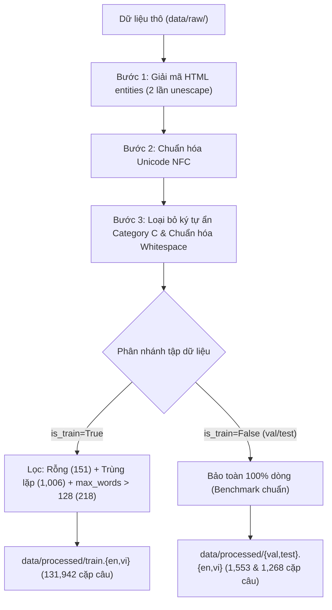

# Báo cáo Tiền xử lý Dữ liệu — Đề tài 8: Dịch máy Anh–Việt (IWSLT'15 En–Vi)

> **Tài liệu lưu trữ:** Bản nháp kỹ thuật phục vụ soạn thảo Proposal (Tuần 1), Báo cáo cuối (Tuần 6) và ôn tập Vấn đáp cá nhân.  
> **Mã nguồn liên quan:** [`src/data/preprocess.py`](../../src/data/preprocess.py), [`data/processed/stats.json`](../../data/processed/stats.json).
---

## 1. Tổng quan & Lựa chọn Nguồn Dữ liệu

### 1.1. Giới thiệu bộ dữ liệu
- **Tên bộ dữ liệu:** IWSLT'15 English–Vietnamese (Stanford NMT benchmark — Luong & Manning, 2015).
- **Miền dữ liệu:** Bản dịch phụ đề các bài diễn thuyết TED Talks (văn phong nói tự nhiên, đa dạng chủ đề khoa học, giáo dục, xã hội).
- **Hướng dịch:** Tiếng Anh (`en`) $\rightarrow$ Tiếng Việt (`vi`).

### 1.2. Lý do lựa chọn nguồn tải dữ liệu
Trong quá trình kiểm tra các nguồn dữ liệu công khai:
1. **Máy chủ gốc Stanford** (`nlp.stanford.edu/projects/nmt/data/iwslt15.en-vi/`) hiện không phản hồi (lỗi timeout khi kết nối).
2. **Một số bản Parquet trên Hugging Face** (như `IWSLT/mt_eng_vietnamese` hoặc `thainq107/iwslt2015-en-vi`) bị lỗi cấu hình script khiến tập `validation` và `test` giống hệt nhau (cùng trỏ về `tst2013`).

Vì vậy, dự án lựa chọn kho lưu trữ chuẩn nguyên bản của Stanford NMT trên Hugging Face tại:
- **Trang chủ bộ dữ liệu:** https://huggingface.co/datasets/dtruong46me/standford-nmt-iwslt15

Bộ dữ liệu gồm đầy đủ 6 tệp song ngữ tách biệt rõ ràng 3 tập:

| Tập dữ liệu | File Tiếng Anh | File Tiếng Việt | Dung lượng thô (KB) | Số dòng gốc |
| :--- | :--- | :--- | ---: | ---: |
| **Train** | `train.en` | `train.vi` | 13,284.8 / 17,651.0 | 133,317 |
| **Validation** (`tst2012`) | `tst2012.en` | `tst2012.vi` | 137.0 / 184.0 | 1,553 |
| **Test** (`tst2013`) | `tst2013.en` | `tst2013.vi` | 129.2 / 179.5 | 1,268 |

---

## 2. Quy trình Tiền xử lý Dữ liệu (`src/data/preprocess.py`)

Dữ liệu thô trong `data/raw/` đi qua quy trình làm sạch gồm 4 bước chính để sinh ra bộ dữ liệu sạch tại `data/processed/` (`train.{en,vi}`, `val.{en,vi}`, `test.{en,vi}`):



### Bước 1: Giải mã HTML entities (`html.unescape`)
- **Hiện trạng dữ liệu thô:** Bộ dữ liệu Stanford NMT đã qua tiền xử lý bằng Moses Tokenizer, do đó các ký tự dấu câu bị chuyển thành HTML entities như `&apos;`, `&quot;`, `&amp;`, `&#91;`, `&#93;`.
- **Xử lý:** Gọi `html.unescape(html.unescape(text))` (giải mã lồng 2 lần để xử lý triệt để cả các chuỗi mã hóa kép như `&amp;apos;`), đưa toàn bộ về ký tự chuẩn (`'`, `"`, `&`, `[`, `]`).
- **Tác dụng:** Ngăn bộ tách từ (Tokenizer) hiểu nhầm các chuỗi như `apos` hay `quot` thành từ vựng riêng biệt.

### Bước 2: Chuẩn hóa bảng mã Unicode tiếng Việt về `NFC`
- **Hiện trạng:** Trong Unicode, ký tự tiếng Việt có dấu có thể tồn tại ở dạng dựng sẵn (**NFC**) hoặc tổ hợp (**NFD** — chữ cái gốc đi kèm dấu rời).
- **Xử lý:** Ép toàn bộ văn bản qua `unicodedata.normalize("NFC", text)`.
- **Tác dụng:** Tránh tình trạng cùng một từ tiếng Việt nhưng bị mã hóa thành 2 token ID khác nhau, gây phân mảnh bộ từ vựng và làm sai lệch điểm BLEU khi đối sánh chuỗi.

### Bước 3: Loại bỏ ký tự điều khiển ẩn & Chuẩn hóa khoảng trắng
- **Xử lý:** Loại bỏ các ký tự điều khiển/định dạng vô hình thuộc nhóm Unicode `"C"` (trừ các ký tự xuống dòng/tab thông thường), sau đó gộp các khoảng trắng liên tiếp về đúng 1 dấu cách và xóa khoảng trắng thừa ở hai đầu câu (`re.sub(r"\s+", " ", text).strip()`).

### Bước 4: Chiến lược lọc phân biệt giữa Tập Huấn luyện và Tập Đánh giá
- **Đối với tập `train` (`is_train=True`):**
  - Loại bỏ các cặp câu có câu nguồn hoặc câu đích bị rỗng sau khi làm sạch (**151 cặp**).
  - Loại bỏ các cặp câu trùng lặp hoàn toàn `(en, vi)` bằng tập hợp `seen_pairs` (**1,006 cặp** — chủ yếu là các câu kết thúc bài nói như *"Thank you ."* — *"Cảm ơn ."*) để tránh mô hình bị thiên lệch (overfitting) vào mẫu lặp.
  - Áp dụng ngưỡng độ dài từ tối đa `--max-words 128` (**loại bỏ 218 cặp câu ngoại lai** có độ dài bất thường > 128 từ, bảo vệ mô hình khỏi tràn bộ nhớ và căn chỉnh tối ưu cho bộ đệm Sequence).
  - *Tổng số cặp câu huấn luyện sạch đạt chuẩn:* **131,942 cặp câu** (nếu không áp dụng ngưỡng độ dài 128 từ, tập train đạt 132,160 cặp câu).
- **Đối với tập `val` (`tst2012`) và `test` (`tst2013`) (`is_train=False`):**
  - **Chỉ làm sạch chuỗi (`clean_text`), tuyệt đối giữ nguyên 100% số lượng câu** (`1,553` câu `val` và `1,268` câu `test`).
  - **Lý do khoa học:** Tập `val` và `test` là bộ kiểm chuẩn cố định (benchmark); việc giữ nguyên toàn bộ mẫu giúp điểm BLEU của mô hình đối sánh công bằng với các công trình trước đây.

---

## 3. Thống kê Dữ liệu Sau Tiền xử lý

Số liệu trích xuất trực tiếp từ [`data/processed/stats.json`](file:///home/bqhwng/dich-may-Anh-Viet/data/processed/stats.json):

### 3.1. Bảng thống kê quy mô và phân bố độ dài câu (tính theo số từ tách bởi khoảng trắng)

| Tập | Số cặp gốc | Sau làm sạch | Đã loại bỏ | Ngôn ngữ | Mean | Median (p50) | p95 | p99 | Min | Max |
| :--- | ---: | ---: | :--- | :---: | ---: | ---: | ---: | ---: | ---: | ---: |
| **Train** | 133,317 | **131,942** | 151 rỗng, 1,006 trùng, 218 dài > 128 | EN | 20.24 | 17.0 | 47.0 | 69.0 | 1 | 122 |
| | | | | VI | 24.75 | 20.0 | 58.0 | 86.0 | 1 | 128 |
| **Val** (`tst2012`) | 1,553 | **1,553** | 0 *(giữ 100%)* | EN | 18.02 | 15.0 | 39.0 | 57.0 | 2 | 93 |
| | | | | VI | 22.08 | 19.0 | 46.4 | 69.0 | 2 | 122 |
| **Test** (`tst2013`) | 1,268 | **1,268** | 0 *(giữ 100%)* | EN | 21.08 | 18.0 | 48.65 | 67.0 | 2 | 102 |
| | | | | VI | 26.56 | 22.0 | 61.0 | 87.0 | 2 | 123 |

*(Lưu ý: Nếu không lọc câu quá 128 từ, tập Train có 132,160 câu, Mean EN: 20.45, Mean VI: 25.02, Max EN: 628, Max VI: 850).*

### 3.2. Biểu đồ Phân bố Độ dài Câu
- Đa số câu tập trung ở dải **10–30 từ** (**62.0%** câu EN và **60.2%** câu VI của tập train).
- Tính trung bình, câu tiếng Việt dài gấp khoảng **1.24 lần** câu tiếng Anh tương ứng (do tiếng Việt là ngôn ngữ đơn lập, mỗi tiếng được tách bởi một khoảng trắng).

### 3.3. Kiểm tra Tỷ lệ Độ dài (Length Ratio) & Cảnh báo Dữ liệu Lệch
- **Tập Train:** Tỷ lệ trung bình $\text{VI}/\text{EN} = 1.24$. Số cặp câu có tỷ lệ lệch bất thường ($>3.0\times$ hoặc $<0.33\times$ với câu $\ge 4$ từ) là **40 câu (0.03%)**, ở mức rất thấp, không ảnh hưởng đáng kể đến huấn luyện.
- **Tập Val & Test:** Tỷ lệ trung bình lần lượt là $1.25$ và $1.28$; **0% câu lệch bất thường**.

### 3.4. Kiểm tra rò rỉ và tách biệt tập dữ liệu (Overlap Check Toàn diện)
- **Trùng lặp cả cặp `(en, vi)`:**
  - `val` vs `test`: **3 cặp** (đều là câu cảm ơn ngắn; xác nhận 2 tập không bị gộp làm một như bản Hugging Face cũ).
  - `train` vs `val`: **12 cặp** (chủ yếu là các câu cực ngắn mang tính xã giao).
  - `train` vs `test`: **12 cặp**.
- **Trùng lặp câu nguồn tiếng Anh (`source_only`):**
  - `val` vs `test`: 3 câu.
  - `train` vs `val`: 14 câu.
  - `train` vs `test`: 13 câu.
- **Kiểm tra HTML entities còn sót:** **0** entities (`&apos;`, `&quot;`, `&amp;`, `&#91;`, `&#93;`, `&lt;`, `&gt;`) trên cả 6 file trong `data/processed/`.

---

### 3.5. Ví dụ thực tế minh họa cho từng bước xử lý & thống kê

#### A. Ví dụ chuẩn hóa ký tự (Giải mã HTML entities & Unicode)
- **Mẫu 1:**
  - *Raw EN:* `Imagine the first piece : a man burning his life &apos;s work .`
  - *Clean EN:* `Imagine the first piece : a man burning his life 's work .`
  - *Clean VI:* `Hãy tưởng tượng mảnh đầu tiên : một người đàn ông đốt cháy sự nghiệp cả đời mình .`
- **Mẫu 2:**
  - *Raw EN:* `He is a poet , a playwright , a man whose whole life had been balanced on the single hope of his country &apos;s unity and freedom .`
  - *Clean EN:* `He is a poet , a playwright , a man whose whole life had been balanced on the single hope of his country 's unity and freedom .`
  - *Clean VI:* `Ông là nhà thơ , nhà viết kịch , một người mà cả cuộc đời chênh vênh trên tia hi vọng duy nhất rằng đất nước ông sẽ độc lập tự do .`
- **Mẫu 3:**
  - *Raw EN:* `I don &apos;t remember the pirates who came many times , but were bluffed by the bravado of the men on our boat , or the engine dying and failing to start for six hours .`
  - *Clean EN:* `I don 't remember the pirates who came many times , but were bluffed by the bravado of the men on our boat , or the engine dying and failing to start for six hours .`
  - *Clean VI:* `Tôi không nhớ lũ cướp biến đã đến rất nhiều lần , nhưng bị lừa bỏ đi bởi sự dũng càm của những người đàn ông trên thuyền , hay là khi máy tàu bị chết và không khởi động được trong suốt sáu tiếng đồng hồ .`

#### B. Ví dụ lọc phân biệt Tập Huấn luyện (`train`) và Tập Đánh giá (`val` / `test`)
- **Các cặp câu rỗng bị loại bỏ ở tập `train` (`151` cặp trong `data/raw/train.{en,vi}`):**
  - *Dòng 470:* `EN: ""` $\longleftrightarrow$ `VI: "̣"` *(tiếng Anh rỗng, tiếng Việt chỉ sót 1 dấu nặng rời rạc)*.
  - *Dòng 8,696:* `EN: ""` $\longleftrightarrow$ `VI: "Khán giả vỗ tay"` *(chú thích sân khấu chỉ có ở một ngôn ngữ)*.
  - *Dòng 9,763:* `EN: ""` $\longleftrightarrow$ `VI: "Vỗ tay ."` *(tương tự, không có câu tiếng Anh tương ứng)*.
  - *Dòng 10,708:* `EN: ""` $\longleftrightarrow$ `VI: "vỗ tay"`
  - *Dòng 21,739:* `EN: ""` $\longleftrightarrow$ `VI: "Vỗ tay"`
- **Các cặp câu trùng lặp bị lọc bỏ ở tập `train` (`1,006` bản sao bị loại):**
  - `("Thank you .", "Cảm ơn .")` xuất hiện **164 lần** (dòng 420, 1005, 3645, 4067, 4848...) $\rightarrow$ giữ lại duy nhất 1 lần ở dòng 420, loại bỏ 163 bản sao.
  - `("Thank you .", "Xin cảm ơn .")` xuất hiện **155 lần** (dòng 1800, 2414, 3741...) $\rightarrow$ giữ lại 1 lần, loại bỏ 154 bản sao.
  - `("Thank you .", "Cảm ơn các bạn .")` xuất hiện **65 lần** (dòng 201, 758, 9081...) $\rightarrow$ giữ lại 1 lần, loại bỏ 64 bản sao.
  - `("Thank you very much .", "Cảm ơn các bạn rất nhiều .")` xuất hiện **44 lần** (dòng 1500, 2453, 2815...) $\rightarrow$ giữ lại 1 lần, loại bỏ 43 bản sao.
- **Đối chứng ở tập `val` (`tst2012`) và `test` (`tst2013`) — GIỮ NGUYÊN 100% (`is_train=False`):**
  - *Tập `val`:* Cặp `("Thank you .", "Cảm ơn .")` xuất hiện 2 lần (dòng 524, 1423) và `("Thank you .", "Cám ơn các bạn .")` xuất hiện 2 lần (dòng 1362, 1479) $\rightarrow$ **giữ nguyên tất cả**, bảo toàn đủ **1,553** cặp câu chuẩn.
  - *Tập `test`:* Cặp `("Thank you .", "Cảm ơn .")` xuất hiện 4 lần (dòng 490, 517, 721, 881) và `("Thank you .", "Cảm ơn các bạn .")` xuất hiện 3 lần (dòng 681, 768, 1144) $\rightarrow$ **giữ nguyên tất cả**, bảo toàn đủ **1,268** cặp câu chuẩn.

#### C. Ví dụ minh họa cho Thống kê Độ dài câu (số dòng tính trên `data/processed/train.{en,vi}`, khác với `data/raw/` do đã lọc bỏ 1,375 dòng)
- **Ngắn nhất (`min = 1` từ EN / `1` từ VI — dòng 39,253 trong `data/processed/train.{en,vi}`):**
  - *EN (1 từ):* `.`
  - *VI (1 từ):* `.`
- **Mức trung vị (`median = 17` từ EN — dòng 2,776 / `20` từ VI — dòng 64,380):**
  - *EN (17 từ):* `Most people would say for a lot , a lot of money -- on good days .`
  - *VI (20 từ):* `Gửi và nhận thư mất đến vài tháng , nếu gặp may . Thường thì chúng chẳng đến nơi .`
- **Ngưỡng phân vị `p95` (`47` từ EN — dòng 90,001 / `58` từ VI — dòng 125,475):**
  - *EN (47 từ):* `I 'm going in , I 'm going to figure this stuff out , I 'm going to spend a year , I 'm going to totally deconstruct shame , I 'm going to understand how vulnerability works , and I 'm going to outsma…`
  - *VI (58 từ):* `Tôi sửng sốt khi thấy ai đó ở góc tối của mạng lưới máy tính toàn cầu lại có thể trở thành tiếng nói của đối phương , thậm chí cho cả tuyến phòng thủ cuối của nó , có lẽ vài người nào đó giống Anonymo…`
- **Ngưỡng phân vị `p99` (`69` từ EN — dòng 40,690 / `86` từ VI — dòng 127,458):**
  - *EN (69 từ):* `You can see the way that the geography of the event is reflected inside of the memorial , and you can search for an individual name , or in this case an employer , Cantor Fitzgerald , and see the way…`
  - *VI (86 từ):* `Điều gì đã giúp David Senged tạo ra những chân tay giả tiện lợi hơn , thoải mái hơn ? Anh lớn lên ở Sierra Leone , nơi rất nhiều người thân của anh mất đi chân tay sau cuộc nội chiến tàn khốc . Khi nh…`
- **Dài nhất đã giữ lại (`max = 122` từ EN — dòng 90,423 / `128` từ VI — dòng 116,612):**
  - *EN (122 từ):* `Now , when you want to use the LFC indoors , all you have to do is pull the levers out of the drivetrain , stow them in the frame , and it converts into a normal wheelchair that you can use just like…`
  - *VI (128 từ):* `Matt cũng trợ giúp tôi thành lập một tổ chức mà hiện tôi đang làm việc với cái tên được đặt theo tiêu đề của một cuốn sách tôi viết , " Những Mảnh Đời Được Cứu Giúp " , nó cố gắng thay đổi văn hoá của…`
- **Dài nhất ngoại lai ở dữ liệu thô (`max = 628` từ EN / `850` từ VI — dòng 15,038 thô đã được loại):**
  - *EN (628 từ):* `Thula Mama , Thula Mama , Thula Mama , Thula Mama . Through the mist of the tears in your eyes on my childhood memory , I know the truth in your smile , I know the truth in your smile , piercing through the gloom of my i...`
  - *VI (850 từ):* `Thula Mama , Thula Mama , Thula Mama , Thula Mama . Trong kí ức tuổi thơ con , qua những giọt lệ nhoè mắt bà , con thấy chân lý trong nụ cười của bà , con thấy chân lý trong nụ cười của bà , xuyên thấu màn đêm u tối tron...`
  - *Giải thích:* Dòng này chứa trọn vẹn lời một bài hát trong TED Talks bị gộp liền thành 1 dòng phụ đề duy nhất — minh chứng trực quan cho thấy vì sao việc giới hạn `--max-words 128` giúp loại bỏ hoàn toàn các mẫu nhiễu này.

#### D. Chi tiết các cặp câu trong Kiểm tra Rò rỉ & Tách biệt Tập Dữ liệu (Overlap Check)
Toàn bộ các cặp câu trùng giữa 3 tập đều là các câu ngắn mang tính xã giao/cảm thán xuất hiện tự nhiên cuối các bài nói, hoàn toàn không có sự rò rỉ nội dung bài diễn thuyết:
- **`val` $\cap$ `test` (3 cặp):**
  1. `("Thank you .", "Cám ơn các bạn .")`
  2. `("Thank you .", "Cảm ơn .")`
  3. `("Thank you .", "Cảm ơn các bạn .")`
- **`train` $\cap$ `val` (12 cặp):**
  1. `("I don 't know .", "Tôi không biết .")`
  2. `("No .", "Không .")`
  3. `("Okay .", "Được rồi .")`
  4. `("Wooo !", "Wooo !")`
  5. `("Thank you .", "Cám ơn các bạn .")` / `("Cảm ơn .")` / `("Cảm ơn các bạn .")` / `("Xin cám ơn các bạn .")` / `("Xin cảm ơn .")` *(5 biến thể)*
  6. `("Thank you very much .", "Cám ơn rất nhiều")` / `("Cảm ơn các bạn rất nhiều")` / `("Cảm ơn các bạn rất nhiều .")` *(3 biến thể)*
- **`train` $\cap$ `test` (12 cặp):**
  1. `("So what happened ?", "Vậy điều gì đã xảy ra ?")`
  2. `("Thanks .", "Cảm ơn")`
  3. `("Thank you .", "Cám ơn .")` / `("Cám ơn các bạn .")` / `("Cảm ơn")` / `("Cảm ơn .")` / `("Cảm ơn bạn .")` / `("Cảm ơn các bạn .")` / `("Cảm ơn quý vị .")` / `("Xin cám ơn")` *(8 biến thể)*
  4. `("Thank you very much .", "Cám ơn rất nhiều .")` / `("Cảm ơn rất nhiều .")` *(2 biến thể)*

---

### 3.6. Tình trạng dữ liệu Train / Validation / Test sau khi qua xử lý (`data/processed/`)

Sau khi chạy hoàn tất `python3 src/data/preprocess.py`, toàn bộ dữ liệu sạch được lưu trữ cục bộ trong thư mục `data/processed/` với trạng thái chi tiết như sau:

| Tập dữ liệu | File đầu ra | Dung lượng (KB) | Số cặp câu | Tổng số từ (Tokens mức từ) | Số từ phân biệt (Unique words) |
| :--- | :--- | ---: | ---: | ---: | ---: |
| **Train** | `train.en` / `train.vi` | 12,704.0 / 17,307.3 | **131,942** | 2,670,454 (EN) / 3,265,896 (VI) | 53,743 (EN) / 25,431 (VI) |
| **Validation** (`tst2012`) | `val.en` / `val.vi` | 132.6 / 182.7 | **1,553** | 27,983 (EN) / 34,297 (VI) | 3,727 (EN) / 2,487 (VI) |
| **Test** (`tst2013`) | `test.en` / `test.vi` | 125.7 / 178.5 | **1,268** | 26,728 (EN) / 33,682 (VI) | 3,917 (EN) / 2,660 (VI) |
| **Metadata thống kê** | `stats.json` | 2.1 | — | Lưu cấu hình, thống kê phân bố và kết quả overlap check | — |

**Checklist xác nhận chất lượng dữ liệu đầu ra (Quality Checklist):**
- **Gióng hàng câu (Sentence alignment):** Khớp chính xác 1:1 giữa `.en` và `.vi` ở cả 3 tập (`131,942` / `1,553` / `1,268`). File thô được đọc theo ký tự xuống dòng `\n` (không dùng `str.splitlines()`, vì hàm này còn tách cả `\x0b`, `\x0c`, `\x85`, `\u2028` nằm giữa câu, gây lệch cặp).
- **Dòng rỗng (Empty lines):** `0` dòng rỗng trên cả 6 file (đã lọc bỏ 151 cặp rỗng trong tập `train`; `val` và `test` vốn không có dòng rỗng).
- **Chuẩn hóa bảng mã:** `100%` sử dụng mã hóa UTF-8 theo chuẩn Unicode dựng sẵn `NFC` (`True` trên cả 6 file).
- **HTML entities còn sót:** `0` trên cả 6 file (`&apos;`, `&quot;`, `&amp;`, `&#91;`, `&#93;`, `&lt;`, `&gt;`).
- **Tính sẵn sàng:** Đã sạch hoàn toàn và sẵn sàng đưa trực tiếp vào bước huấn luyện bộ tách từ BPE (`src/data/tokenizer.py`) và xây dựng PyTorch `DataLoader` (`src/data/dataset.py`).

---

## 4. Nhận xét & Định hướng cho Giai đoạn tiếp theo (Tokenizer & Model)

1. **Lựa chọn ngưỡng độ dài chuỗi (`max_seq_len`):**
   - Trong tập `train`, việc lọc `--max-words 128` đã loại bỏ hoàn toàn các câu ngoại lai dài 600-800 từ (do dính phụ đề cả bài hát).
   - **95%** số câu ngắn hơn hoặc bằng `47` từ (EN) / `58` từ (VI), và **99%** số câu nằm dưới `69` từ (EN) / `86` từ (VI).
   - Vì độ phức tạp bộ nhớ của cơ chế Self-Attention trong Transformer là $\mathcal{O}(L^2)$, thiết lập ngưỡng `max_len = 160` (BPE tokens) ở `src/data/dataset.py` vừa bao quát $>99.99\%$ dữ liệu, vừa tối ưu hóa bộ nhớ GPU.
2. **Chênh lệch độ dài giữa Tiếng Anh và Tiếng Việt:**
   - Số lượng từ/tiếng trung bình của tiếng Việt luôn cao hơn tiếng Anh khoảng **22%–26%** (`24.75` vs `20.24` ở `train`; `26.56` vs `21.08` ở `test`) do tiếng Việt là ngôn ngữ đơn lập, mỗi âm tiết tách rời thành một khoảng trắng (ví dụ một từ tiếng Anh *"freedom"* tương ứng 2 tiếng *"tự do"*).
3. **Đặc điểm dấu câu đã tách sẵn:**
   - Dữ liệu gốc đã được Moses tách dấu câu bằng khoảng trắng (ví dụ `life 's work .`). Khi huấn luyện bộ tách từ BPE ở bước sau cần lưu ý thiết lập pre-tokenizer phù hợp và kiểm tra bước hậu xử lý (detokenize) trước khi tính SacreBLEU.

---

## 5. Hướng dẫn Tái hiện (Reproducibility)

Chạy lệnh sau từ thư mục gốc dự án để tái tạo `data/processed/` (yêu cầu 6 file gốc đã có sẵn trong `data/raw/`, tải từ link Hugging Face ở mục 1.2):

```bash
# Tiền xử lý dữ liệu sang data/processed/ và sinh stats.json
python3 src/data/preprocess.py --max-words 128
```

> [!NOTE]
> Script tải dữ liệu (`scripts/download_data.py`), script vẽ biểu đồ (`scripts/generate_charts.py`) và unit test (`tests/test_data_pipeline.py`) chưa có trong repo.
