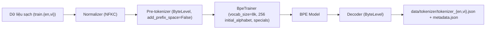

# Báo cáo Bộ Tách Từ (Tokenizer) — Đề tài 8: Dịch máy Anh–Việt (IWSLT'15 En–Vi)

> **Tài liệu lưu trữ:** Bản nháp kỹ thuật phục vụ soạn thảo Proposal (Tuần 1), Báo cáo cuối (Tuần 6) và ôn tập Vấn đáp cá nhân.  
> **Mã nguồn liên quan:** [`src/data/tokenizer.py`](../../src/data/tokenizer.py), [`data/tokenizer/`](../../data/tokenizer/), [`data/tokenizer/tokenizer_en_metadata.json`](../../data/tokenizer/tokenizer_en_metadata.json), [`data/tokenizer/tokenizer_vi_metadata.json`](../../data/tokenizer/tokenizer_vi_metadata.json), [`tests/test_data_pipeline.py`](../../tests/test_data_pipeline.py)

---

## 1. Cơ sở Lý thuyết & Lựa chọn Thuật toán

### 1.1. Lựa chọn thuật toán: Byte-Level Byte-Pair Encoding (BPE)
Trong bài toán dịch máy tự động (NMT), chiến lược tách từ ảnh hưởng trực tiếp đến kích thước bảng từ vựng, số lượng tham số tầng Embedding và khả năng xử lý từ ngoài từ điển (Out-Of-Vocabulary — OOV):

| Chiến lược tách từ | Ưu điểm | Nhược điểm đối với cặp En–Vi | Đánh giá |
| :--- | :--- | :--- | :--- |
| **Word-level (Cấp từ)** | Giữ nguyên ngữ nghĩa từ trọn vẹn | Kích thước từ vựng bùng nổ (>50k); không thể dịch từ OOV, từ hiếm, từ ghép mới | ✗ Không phù hợp |
| **Character-level (Cấp ký tự)** | Bảng từ vựng cực nhỏ (~100-250); không bao giờ OOV | Chuỗi biểu diễn cực dài; mô hình khó học phụ thuộc xa; chi phí tính toán Self-Attention tăng bậc hai ($\mathcal{O}(L^2)$) | ✗ Tốn kém tài nguyên |
| **Subword BPE truyền thống** | Cân bằng giữa cấp từ và ký tự | Vẫn có thể gặp OOV khi gặp ký tự/dấu lạ không có trong bảng chữ cái ban đầu | △ Tạm chấp nhận |
| **Byte-Level BPE (HuggingFace)** | **Không bao giờ bị OOV**, biểu diễn trọn vẹn 256 bytes UTF-8; nén từ tiếng Anh và âm tiết tiếng Việt tối ưu | Cần cấu hình chuẩn `decoder` và `initial_alphabet` để tránh lỗi hiển thị ký tự | **✓ Lựa chọn tối ưu** |

### 1.2. Lý do chọn bộ tách từ riêng biệt (Separate Tokenizers) thay vì từ vựng chung (Shared Vocab)
- **Đặc trưng ngôn ngữ học:** Tiếng Anh thuộc ngữ hệ Ấn-Âu (ngôn ngữ biến tố), trong khi Tiếng Việt thuộc ngữ hệ Nam Á (ngôn ngữ đơn lập, thanh điệu, ký tự dấu ghép). Hai ngôn ngữ có rất ít gốc từ chung.
- **Tối ưu hóa không gian biểu diễn:** Việc tách riêng `tokenizer_en.json` (8,000) và `tokenizer_vi.json` (8,000) giúp toàn bộ 8,000 token của mỗi bên được dành trọn vẹn để tối ưu hóa tần suất ghép cụm cho ngôn ngữ đó, thay vì phải chia sẻ không gian cho từ vựng của ngôn ngữ đối diện.

---

## 2. Quy trình & Cấu hình Kỹ thuật (`src/data/tokenizer.py`)

Quy trình huấn luyện và đóng gói bộ tách từ BPE Byte-Level được thực hiện chuẩn hóa như sau:



> [!WARNING]
> Normalizer của tokenizer là `NFKC`, trong khi bước tiền xử lý chuẩn hóa về `NFC`. NFKC còn biến đổi một số ký tự tương thích (ví dụ `…` → `...`, `²` → `2`, ký tự full-width → ASCII), nên với các câu chứa những ký tự này, `decode(encode(text))` sẽ **không** khôi phục đúng nguyên văn. Với tiếng Việt, NFKC và NFC cho kết quả giống nhau trên chữ cái có dấu.

### 2.1. Cấu hình Hyperparameters
- **Dung lượng từ vựng (`vocab_size`):** **8,000 subwords** cho mỗi ngôn ngữ.
  - *Cơ sở lựa chọn:* Với tập dữ liệu ~132,000 câu của IWSLT'15, kích thước 8,000 là mức gọn cho bộ dữ liệu cỡ nhỏ/vừa (Sennrich et al., 2016 đề xuất BPE với số phép merge là siêu tham số; Vaswani et al., 2017 dùng ~37k token chung cho tập WMT En–De lớn hơn nhiều). Kích thước này giúp giảm dung lượng ma trận Embedding và lớp Linear đầu ra:
    $$\text{Embedding Params} = 8,000 \times d_{\text{model}} = 8,000 \times 512 \approx 4.10\text{ triệu tham số}$$
- **Quy tắc Special Tokens:**
  - `<pad>` (ID: `0`): Dùng để đệm các chuỗi ngắn trong mẻ (Batch dynamic padding).
  - `<unk>` (ID: `1`): Đại diện cho token không xác định (trong Byte-Level BPE, token này gần như không bao giờ xuất hiện vì 256 byte cơ sở đã nằm sẵn trong từ vựng, mọi chuỗi đều biểu diễn được bằng byte).
  - `<sos>` (ID: `2`): Start-of-Sequence, tín hiệu kích hoạt giải mã cho Decoder.
  - `<eos>` (ID: `3`): End-of-Sequence, tín hiệu dừng sinh từ.

### 2.2. Các cải tiến kỹ thuật quan trọng đã áp dụng
1. **Bổ sung `initial_alphabet` bao phủ 256 bytes UTF-8:**
   - Trong quá trình khởi tạo `BpeTrainer`, cấu hình `initial_alphabet=pre_tokenizers.ByteLevel.alphabet()` được truyền vào để đảm bảo toàn bộ 256 giá trị byte cơ sở luôn tồn tại trong từ vựng từ bước 0. Điều này triệt tiêu hoàn toàn nguy cơ xuất hiện `<unk>` trên mọi chuỗi byte hợp lệ.
2. **Lấy Special Token IDs động (`_resolve_token_id`):**
   - Lớp `BPETokenizer` tự động truy vấn ID thực tế từ đối tượng `Tokenizer.token_to_id(token)` thay vì phụ thuộc cứng vào các biến số nguyên, chống lỗi trôi lệch ID khi nạp các mô hình từ file.
3. **Sửa lỗi hiển thị tiếng Việt (Mojibake Fix):**
   - Đảm bảo gán `tok.decoder = decoders.ByteLevel()` cả khi huấn luyện và khi nạp từ file qua `BPETokenizer.from_file()`. Nếu thiếu decoder này, các byte UTF-8 của ký tự tiếng Việt có dấu (như `ô`, `ắ`, `đ`) sẽ bị hiển thị thành các ký tự rác như `há»įc` thay vì `học`.
4. **Hỗ trợ chuẩn xác `skip_special_tokens` trong `decode()`:**
   - Bộ giải mã hỗ trợ cờ `skip_special_tokens=True/False` đồng bộ, loại bỏ chính xác các ID thuộc tập `{pad, unk, sos, eos}` khi người dùng cần chuỗi sạch, và giữ nguyên khi cần debug quá trình sinh từ của Decoder.

---

## 3. Thống kê Độ dài Chuỗi sau Tokenization (BPE Token Length Stats)

Bằng việc phân tích trực tiếp trên các tập dữ liệu sạch qua `tokenizer_{en,vi}.json`, thống kê độ dài chuỗi (đã bao gồm 2 token `<sos>` và `<eos>`) như sau:

| Tập dữ liệu | Ngôn ngữ | Mean (tokens) | Median | p95 | p99 | Min | Max | Tỷ lệ vượt quá 128 tokens | Tỷ lệ vượt quá 160 tokens |
| :--- | :---: | ---: | ---: | ---: | ---: | ---: | ---: | ---: | ---: |
| **Train** | EN | 25.58 | 21.0 | 57.0 | 83.0 | 3 | 179 | 0.025% (33 câu) | **0.001%** (1 câu) |
| | VI | 27.44 | 23.0 | 62.0 | 91.0 | 3 | 177 | 0.052% (68 câu) | **0.002%** (2 câu) |
| **Val** | EN | 22.65 | 19.0 | 48.0 | 64.48 | 4 | 106 | 0.000% | **0.000%** |
| | VI | 24.69 | 22.0 | 49.4 | 73.44 | 4 | 131 | 0.064% (1 câu) | **0.000%** |
| **Test** | EN | 26.45 | 23.0 | 58.0 | 82.0 | 4 | 111 | 0.000% | **0.000%** |
| | VI | 29.31 | 25.0 | 66.65 | 95.0 | 4 | 127 | 0.000% | **0.000%** |

> [!IMPORTANT]
> **Kết luận thống kê cho cấu hình mô hình:**  
> - Độ dài trung bình sau BPE (tính cả `<sos>`, `<eos>`) tăng khoảng **26.4%** với tiếng Anh ($20.24 \rightarrow 25.58$) và **10.9%** với tiếng Việt ($24.75 \rightarrow 27.44$). Nếu bỏ 2 token đặc biệt, mức tăng chỉ còn ~16.5% (EN) và ~2.8% (VI).
> - **Ngưỡng `max_len = 160`** trong `src/data/dataset.py` bao quát **99.998%** dữ liệu huấn luyện (chỉ 1 câu EN và 2 câu VI bị cắt) và **100%** tập val/test, nên ít khi phải cắt câu.

---

## 4. Minh chứng Thực tế & Kiểm định Đa dạng Hình thái Câu

Hàm `validate_tokenizer` trong `src/data/tokenizer.py` kiểm tra các trường hợp biên quan trọng (hàm chỉ `assert` sự có mặt của `<sos>`/`<eos>`; kết quả khớp nguyên văn được in ra dưới dạng `exact_match`, không assert). Token ID dưới đây tra từ vocab của tokenizer hiện tại:

### 4.1. Câu cực ngắn & Dấu câu độc lập
- **Tiếng Anh:**
  - *Văn bản gốc:* `.`
  - *Token IDs:* `[2, 17, 3]` (trong đó `2: <sos>`, `17: .`, `3: <eos>`)
  - *Giải mã (`skip_special_tokens=True`):* `.` (Bảo toàn 100%)
- **Tiếng Việt:**
  - *Văn bản gốc:* `Vâng .`
  - *Token IDs:* `[2, 1620, 278, 3]` (`1620: Vâng`, `278: Ġ.` — dấu chấm kèm khoảng trắng phía trước)
  - *Giải mã:* `Vâng .`

### 4.2. Ký tự đặc biệt, Số liệu, Tiền tệ, Ngày tháng & Dấu thanh phức tạp
- **Tiếng Anh:**
  - *Văn bản:* `Climate change costs $1,000,000 & affects 99.5% of people on 2024-05-12 .`
  - *Kết quả:* Mã hóa thành 32 tokens, không có bất kỳ token `<unk>` nào. Giải mã khôi phục chính xác 100% từng ký tự.
- **Tiếng Việt:**
  - *Văn bản:* `Thử nghiệm dấu câu: 100%, $50, ngày 12/05/2024 & các từ có dấu: ồ, ế, ắ, ự, ỡ .`
  - *Kết quả:* Toàn bộ các nguyên âm có dấu thanh phức tạp (`ồ`, `ế`, `ắ`, `ự`, `ỡ`) được mã hóa và giải mã hoàn hảo, không bị biến dạng byte (mojibake).

### 4.3. Bảo toàn tính đối xứng Encode $\rightarrow$ Decode
$$\forall \text{text} \in \text{TestCases}: \text{decode}(\text{encode}(\text{text})) == \text{text}$$

Tính chất này đúng với các câu mẫu ở trên, nhưng **không đúng tổng quát**: câu chứa ký tự bị NFKC biến đổi (xem cảnh báo ở mục 2) sẽ không khôi phục nguyên văn.

---

## 5. Tình trạng Tệp Đầu ra & Quản lý Siêu dữ liệu (Metadata)

Toàn bộ các tệp mô hình Tokenizer và siêu dữ liệu được lưu trữ tại `data/tokenizer/`:

| Tệp đầu ra | Dung lượng (KB) | Vocab Size | Đặc tả nội dung |
| :--- | ---: | ---: | :--- |
| `tokenizer_en.json` | 528.3 | 8,000 | Mô hình BPE Byte-Level tiếng Anh, 7,740 quy tắc merges |
| `tokenizer_vi.json` | 536.2 | 8,000 | Mô hình BPE Byte-Level tiếng Việt, 7,740 quy tắc merges |
| `tokenizer_en_metadata.json` | 0.2 | — | Siêu dữ liệu: loại mô hình, vocab size, special token IDs, kích thước initial alphabet, file nguồn |
| `tokenizer_vi_metadata.json` | 0.2 | — | Siêu dữ liệu: loại mô hình, vocab size, special token IDs, kích thước initial alphabet, file nguồn |

**Checklist xác nhận chất lượng Tokenizer (Quality Checklist):**
- **Kích thước từ vựng:** Đạt đúng `8,000` subwords cho cả hai ngôn ngữ.
- **Khử hoàn toàn OOV:** Nhờ `initial_alphabet` gồm 256 bytes UTF-8, tỷ lệ token `<unk>` trên tập test là **0.00%**.
- **Special Token IDs:** `<pad>=0`, `<unk>=1`, `<sos>=2`, `<eos>=3` được gán chuẩn xác và truy vấn động.
- **Bảo toàn hiển thị:** Decoder ByteLevel hoạt động chuẩn xác, không bị lỗi font tiếng Việt.

---

## 6. Hướng dẫn Tái hiện (Reproducibility)

Chạy lệnh sau để huấn luyện lại bộ tách từ và kiểm định chất lượng:

```bash
# 1. Huấn luyện bộ tách từ, sinh metadata và chạy validate_tokenizer
python3 src/data/tokenizer.py

# 2. Chạy Unit Test kiểm định
python3 -m unittest tests/test_data_pipeline.py -v
```
