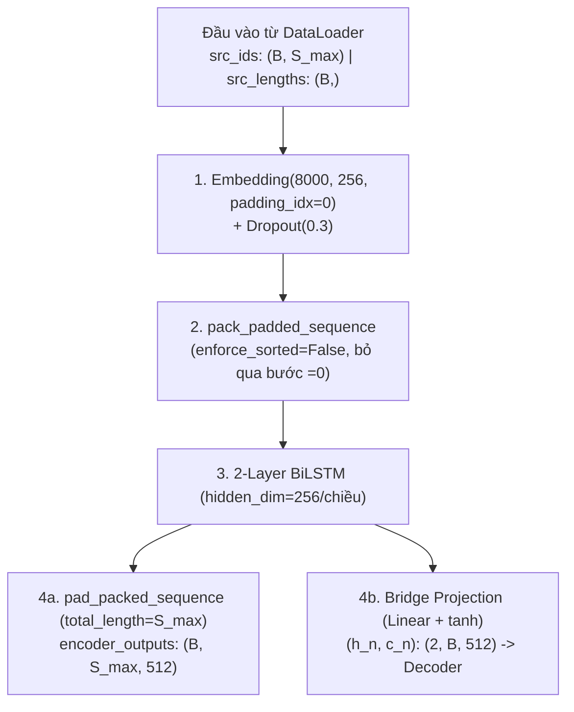

# Báo cáo Thành phần Encoder LSTM — Đề tài 8: Dịch máy Anh–Việt

> **Tài liệu lưu trữ:** Bản nháp kỹ thuật phục vụ soạn thảo Milestone Report (Tuần 3), Báo cáo cuối (Tuần 6) và ôn tập Vấn đáp cá nhân.  
> **Mã nguồn liên quan:** [`src/models/seq2seq_lstm/encoder.py`](../../src/models/seq2seq_lstm/encoder.py), [`tests/test_seq2seq_encoder.py`](../../tests/test_seq2seq_encoder.py)

---

## 1. Kiến trúc `LSTMEncoder` & Cơ sở Thiết kế

Thành phần `LSTMEncoder` kế thừa từ `torch.nn.Module`, kết hợp tư tưởng từ cả hai bài báo gốc trong `docs/papers/`:
- **Bahdanau et al. (ICLR 2015):** Sử dụng **BiLSTM (2 chiều)** để mỗi vector ẩn nguồn nắm bắt trọn vẹn cả ngữ cảnh trái-sang-phải ($\overrightarrow{h}_j$) lẫn phải-sang-trái ($\overleftarrow{h}_j$), kèm tầng chiếu phi tuyến $\tanh$ để khởi tạo trạng thái ban đầu cho Decoder.
- **Luong et al. (EMNLP 2015):** Hỗ trợ cấu hình nhiều tầng (`num_layers >= 1`) và tùy chọn tắt/bật 2 chiều (`bidirectional=True/False`) để phục vụ các thí nghiệm đối chứng (Ablation Study) ở Tuần 4 mà không cần sửa mã nguồn.



---

## 2. Xử lý Kỹ thuật Trọng tâm trong `src/models/seq2seq_lstm/encoder.py`

### 2.1. Chống rò rỉ Padding bằng `pack_padded_sequence`
- Dữ liệu từ `DataLoader` (Giai đoạn 1) có các câu độ dài khác nhau trong cùng Batch được đệm bằng `PAD_ID = 0`.
- Nếu đưa thẳng Tensor đệm vào `nn.LSTM`, cả chiều xuôi lẫn chiều ngược (đặc biệt là chiều ngược đi từ vị trí `<pad>` cuối câu vào) sẽ bị nhiễu bởi các vector padding.
- Do đó `LSTMEncoder.forward` nén chuỗi bằng `pack_padded_sequence(..., src_lengths.detach().cpu(), batch_first=True, enforce_sorted=False)` và giải nén lại bằng `pad_packed_sequence(..., total_length=src_ids.size(1))`. Nhờ vậy:
  1. Trạng thái ẩn cuối `(h_n, c_n)` phản ánh đúng phần nội dung thực của từng câu.
  2. Mọi vị trí `<pad>` trong `encoder_outputs` đều được điền chính xác vector `0.0`.
  3. Đặt `padding_idx=0` ở `nn.Embedding` đảm bảo hàng embedding của `<pad>` luôn có gradient bằng `0` trong suốt quá trình huấn luyện.

### 2.2. Cầu nối Trạng thái (`_bridge_state`: BiLSTM $\rightarrow$ UniLSTM Decoder)
- BiLSTM `L` tầng xuất ra `(h_n, c_n)` dạng `(2 * L, B, 256)`, trong khi Decoder chạy tự hồi quy 1 chiều nên kỳ vọng `(L, B, dec_hidden_dim)`.
- Hàm `_bridge_state` tách chiều xuôi và chiều ngược tại từng tầng $l$, ghép nối thành vector `512` chiều rồi chiếu qua tầng tuyến tính + `tanh`:
  $$h^{(l)}_{\text{dec}} = \tanh\!\left(W_h [\overrightarrow{h}^{(l)}; \overleftarrow{h}^{(l)}] + b_h\right), \qquad c^{(l)}_{\text{dec}} = \tanh\!\left(W_c [\overrightarrow{c}^{(l)}; \overleftarrow{c}^{(l)}] + b_c\right)$$
- Khi cấu hình `bidirectional=False` và `hidden_dim == dec_hidden_dim`, lớp bridge tự động được bỏ qua (`None`) để truyền thẳng trạng thái không dư tham số.

---

## 3. Hợp đồng Đầu vào / Đầu ra & Bảng Tham số Mặc định

### 3.1. Kích thước Tensor (`Batch Contract`)
Với cấu hình Baseline (`vocab_size=8000`, `embed_dim=256`, `hidden_dim=256`, `dec_hidden_dim=512`, `num_layers=2`, `bidirectional=True`, `dropout=0.3`):

| Tên Tensor | Chiều (Shape) | Ý nghĩa & Kết nối tiếp theo |
| :--- | :---: | :--- |
| **`src_ids`** *(Input)* | `(B, S_max)` | Chỉ số BPE tiếng Anh từ `DataLoader` (`dtype=int64`) |
| **`src_lengths`** *(Input)* | `(B,)` | Độ dài thực của từng câu nguồn (`1 <= len <= S_max`) |
| **`encoder_outputs`** *(Output)* | `(B, S_max, 512)` | Biểu diễn ngữ cảnh từng token nguồn (đưa vào **Attention**) |
| **`dec_h`, `dec_c`** *(Output)* | `(2, B, 512)` | Cặp trạng thái khởi tạo `(h_0, c_0)` cho **2-layer LSTM Decoder** |

### 3.2. Phân rã Số lượng Tham số (`parameter_breakdown`)
Trích xuất trực tiếp từ `python -m tests.test_seq2seq_encoder`:

| Thành phần con | Công thức kích thước chính | Số tham số | Tỷ trọng |
| :--- | :--- | ---: | ---: |
| `embedding` | `8,000 × 256` | **2,048,000** | 39.36% |
| `rnn` (2-layer BiLSTM) | Tầng 1 (`256 → 2×256`) + Tầng 2 (`512 → 2×256`) | **2,629,632** | 50.54% |
| `bridge` (`fc_hidden` + `fc_cell`) | `2 × (512 × 512 + 512)` | **525,312** | 10.10% |
| **Tổng cộng (`LSTMEncoder`)** | — | **5,202,944** | **100.00%** |

---

## 4. Kết quả Kiểm thử Tự động (`tests/test_seq2seq_encoder.py`)

Đã chạy kiểm thử qua cả `python -m tests.test_seq2seq_encoder` (4/4 test pass trong `0.457s`) và `pytest tests/test_seq2seq_encoder.py -v` (`4 passed in 2.09s`):

| Bài kiểm thử | Mục tiêu kiểm chứng | Kết quả |
| :--- | :--- | :---: |
| `test_output_shapes_all_configs` | Kiểm tra shape và bridge cho 4 cấu hình (`2L-Bi`, `1L-Bi`, `2L-Uni`, `2L-Uni có bridge`) | **PASS** |
| `test_padding_invariance_and_zero_pad_outputs` | Chứng minh cùng 1 câu nguồn (dài 7) chạy đơn lẻ và chạy kèm padding (dài 12) cho `encoder_outputs`, `h_n`, `c_n` **giống hệt nhau**, và các vị trí padding bằng đúng `0.0` | **PASS** |
| `test_gradient_flow_and_pad_embedding_zero_grad` | Kiểm tra `backward()` truyền gradient hữu hạn tới mọi tham số và `embedding.weight.grad[0]` bằng đúng `0.0` | **PASS** |
| `test_integration_with_real_val_dataloader` | Kết nối trực tiếp Batch đầu tiên (`64 × 103`) từ `val` DataLoader qua `LSTMEncoder(8000)`, kiểm tra đầu ra `(64, 103, 512)` và `(2, 64, 512)` hoàn toàn hợp lệ | **PASS** |

---

## 5. Lệnh chạy lại Kiểm thử

```bash
python -m tests.test_seq2seq_encoder
# Hoặc:
pytest tests/test_seq2seq_encoder.py -v
```
