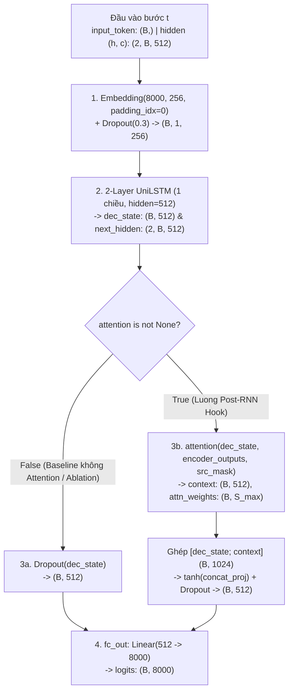

# Báo cáo Thành phần Decoder LSTM — Đề tài 8: Dịch máy Anh–Việt

> **Tài liệu lưu trữ:** Bản nháp kỹ thuật phục vụ soạn thảo Milestone Report (Tuần 3), Báo cáo cuối (Tuần 6) và ôn tập Vấn đáp cá nhân.  
> **Mã nguồn liên quan:** [`src/models/seq2seq_lstm/decoder.py`](../../src/models/seq2seq_lstm/decoder.py), [`src/models/seq2seq_lstm/encoder.py`](../../src/models/seq2seq_lstm/encoder.py), [`tests/test_seq2seq_decoder.py`](../../tests/test_seq2seq_decoder.py)

---

## 1. Kiến trúc `LSTMDecoder` (Giải mã từng bước & Khe cắm nóng Attention)

Khối `LSTMDecoder` chạy **tự hồi quy 1 chiều** (từ trái sang phải, dự đoán từng token tiếng Việt tại mỗi bước thời gian $t$) và hỗ trợ song song **2 chế độ hoạt động** thông qua tham số tùy chọn `attention: nn.Module | None = None`:



1. **Chế độ không Attention (`attention=None`):** Tín hiệu `dec_state` đi qua `Dropout` rồi chiếu thẳng ra từ điển 8,000 token qua `fc_out`. Thiết kế này cho phép kiểm định ngay chuỗi `LSTMEncoder -> LSTMDecoder` trước khi viết tầng Attention, đồng thời dùng làm mô hình đối chứng (*No-Attention Ablation*) ở Tuần 4.
2. **Chế độ có Attention (Chuẩn Luong Post-RNN):** Tầng LSTM cập nhật `dec_state` trước, sau đó gọi `attention(dec_state, encoder_outputs, src_mask)` để lấy `context` và `attn_weights`, ghép `[dec_state; context]` (`1024` chiều) đưa qua tầng `concat_proj + tanh` (theo Luong et al., 2015) rồi chiếu ra `logits (B, 8000)`. Khi gắn tầng Attention thật ở bước sau, không cần sửa bất kỳ dòng nào trong `LSTMDecoder`.

---

## 2. Hợp đồng Đầu vào / Đầu ra (`Single-Step Contract`)

Với cấu hình mặc định đồng bộ cùng `LSTMEncoder` (`vocab_size=8000`, `embed_dim=256`, `hidden_dim=512`, `enc_out_dim=512`, `num_layers=2`, `dropout=0.3`):

| Thành phần | Tên biến | Kích thước (Shape) | Ghi chú |
| :--- | :--- | :---: | :--- |
| **Input** | `input_token` | `(B,)` hoặc `(B, 1)` | Token tiếng Việt bước $t$ (bước $t=0$ là `<bos>=2`) |
| **Input** | `hidden` `(h, c)` | `(2, B, 512)` mỗi tensor | Bước $t=0$ nhận trực tiếp từ `LSTMEncoder`; các bước sau dùng `next_hidden` của bước $t-1$ |
| **Input (tùy chọn)** | `encoder_outputs`, `src_mask` | `(B, S_max, 512)`, `(B, S_max)` | Chỉ bắt buộc khi `attention is not None` (`src_mask=False` tại các ô `<pad>`) |
| **Output** | `logits` | `(B, 8000)` | Điểm số chưa qua Softmax (tính `CrossEntropyLoss` hoặc `argmax`/Beam Search) |
| **Output** | `next_hidden` `(h_t, c_t)` | `(2, B, 512)` mỗi tensor | Trạng thái cập nhật chuyển cho bước $t+1$ |
| **Output** | `attn_weights` | `(B, S_max)` hoặc `None` | Trọng số chú ý lên câu nguồn (bằng `None` nếu không gắn Attention) |

---

## 3. Phân rã & Công thức Tính Tham số (`parameter_breakdown`)

Trích xuất từ `python -m tests.test_seq2seq_decoder` (đối chiếu với công thức tay cho LSTM 1 chiều $4H(I + H + 2)$):

| Thành phần con | Công thức tính tay | Thay số cụ thể | Tham số (`attention=None`) | Tham số (Có Hook Attention) |
| :--- | :--- | :--- | ---: | ---: |
| **`embedding`** | $V \times E$ | $8,000 \times 256$ | **2,048,000** | **2,048,000** |
| **`rnn` – Tầng 1** | $4H(E + H + 2)$ | $4(512)(256 + 512 + 2)$ | 1,576,960 | 1,576,960 |
| **`rnn` – Tầng 2** | $4H(H + H + 2)$ | $4(512)(512 + 512 + 2)$ | 2,101,248 | 2,101,248 |
| $\hookrightarrow$ *Tổng `rnn` (2 tầng)* | *Tầng 1 + Tầng 2* | — | **3,678,208** | **3,678,208** |
| **`concat_proj`** | $(H + D_{\text{enc}}) \cdot H + H$ | $(512 + 512) \times 512 + 512$ | *Không dùng (`0`)* | **524,800** |
| **`fc_out`** | $H \cdot V + V$ | $512 \times 8,000 + 8,000$ | **4,104,000** | **4,104,000** |
| **Tổng cộng Decoder** *(chưa tính trọng số riêng trong Attention)* | — | — | **9,830,208** | **10,355,008** |

*(Kết hợp với `LSTMEncoder` `5,202,944` tham số $\Rightarrow$ cặp `Encoder + Decoder` hiện đạt `15,033,152` tham số khi chưa có Attention và `15,557,952` tham số khi bật `concat_proj`).*

---

## 4. Kết quả Kiểm thử Tự động (`tests/test_seq2seq_decoder.py`)

Đã chạy kiểm định bằng cả `python -m tests.test_seq2seq_decoder` (4/4 test pass trong `1.837s`) và `pytest tests/test_seq2seq_decoder.py -v` (`4 passed in 3.50s`):

| Bài kiểm thử | Mục tiêu kiểm chứng | Kết quả |
| :--- | :--- | :---: |
| `test_single_step_shapes_no_attention` | Kiểm tra shape đầu ra `(B, 200)` và `next_hidden` với cả `input_token` 1D `(B,)` & 2D `(B, 1)`, cho cả 1 và 2 tầng | **PASS** |
| `test_plug_and_play_attention_hook` | Kiểm tra khe cắm Attention bằng `_DummyAttention`: `concat_proj` kích hoạt, `attn_weights` có tổng bằng `1.0`, vùng `~src_mask` bằng đúng `0.0`, và báo lỗi `ValueError` nếu thiếu `encoder_outputs` | **PASS** |
| `test_multi_step_gradient_flow_and_pad_zero_grad` | Unroll 4 bước thời gian cho cả 2 chế độ (`attention=False/True`), chạy `CrossEntropyLoss(ignore_index=0)` + `backward()`, xác nhận mọi tham số có gradient hữu hạn và dòng `<pad>` (`index 0`) giữ gradient bằng `0.0` | **PASS** |
| `test_integration_encoder_to_decoder_real_val_batch` | Nối trực tiếp `LSTMEncoder(8000)` $\rightarrow$ `LSTMDecoder(8000)` trên Batch đầu tiên (`64 × 103`, `64 × 127`) từ `val` DataLoader, kiểm tra `logits (64, 127, 8000)` và `Loss` khởi tạo nằm trong ngưỡng chuẩn `(8.5, 9.5)` (gần $\ln(8000) \approx 8.9872$) | **PASS** |

---

## 5. Lệnh chạy lại Kiểm thử

```bash
python -m tests.test_seq2seq_decoder
# Hoặc:
pytest tests/test_seq2seq_decoder.py -v
```
