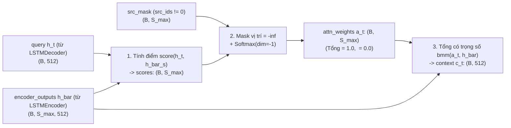

# Báo cáo Khối Luong Global Attention — Đề tài 8: Dịch máy Anh–Việt

> **Tài liệu lưu trữ:** Bản nháp kỹ thuật phục vụ soạn thảo Milestone Report (Tuần 3), Báo cáo cuối (Tuần 6) và ôn tập Vấn đáp cá nhân.  
> **Mã nguồn liên quan:** [`src/models/seq2seq_lstm/attention.py`](../../src/models/seq2seq_lstm/attention.py), [`src/models/seq2seq_lstm/decoder.py`](../../src/models/seq2seq_lstm/decoder.py), [`tests/test_seq2seq_attention.py`](../../tests/test_seq2seq_attention.py)

---

## 1. Cơ sở Lý thuyết & Luồng Tính toán (`LuongAttention`)

Khối `LuongAttention` cài đặt cơ chế **Global Attention** theo bài báo **Luong, Pham & Manning (EMNLP 2015)** (*Effective Approaches to Attention-based Neural Machine Translation*, tài liệu trong `docs/papers/`). Tại mỗi bước dịch $t$, cơ chế này sử dụng toàn bộ tập trạng thái ẩn của Encoder $\bar{h}_1, \dots, \bar{h}_{S_{\max}}$ cùng trạng thái ẩn hiện tại của Decoder $h_t$:



### 1.1. Các bước toán học (Công thức 5–8 của Luong et al., 2015)
1. **Tính điểm tương đồng (Công thức 8 — hỗ trợ đủ cả 3 biến thể qua `method`):**
   $$\text{score}(h_t, \bar{h}_s) = \begin{cases} h_t^\top \bar{h}_s & (\text{dot}) \\ h_t^\top W_a \bar{h}_s & (\text{general — mặc định}) \\ v_a^\top \tanh(W_q h_t + W_k \bar{h}_s) & (\text{concat}) \end{cases}$$
   *(Biến thể `concat` tách riêng phép chiếu $W_q h_t + W_k \bar{h}_s$ thay vì lặp `concat` rồi nhân ma trận dọc chiều $S_{\max}$, cho kết quả toán học tương đương $v_a^\top \tanh(W_a[h_t; \bar{h}_s])$ nhưng tiết kiệm bộ nhớ đáng kể).*
2. **Che padding và chuẩn hóa trọng số gióng hàng (Công thức 7):**
   Gán `scores = -inf` tại những vị trí `src_mask == False` (`<pad>`), sau đó lấy phân phối xác suất:
   $$a_t(s) = \frac{\exp(\text{score}(h_t, \bar{h}_s))}{\sum_{s'} \exp(\text{score}(h_t, \bar{h}_{s'}))}$$
3. **Tính vector ngữ cảnh $c_t$:**
   $$c_t = \sum_{s=1}^{S_{\max}} a_t(s) \bar{h}_s$$
4. **Kết hợp xuất dự đoán từ (Công thức 5–6, thực hiện trong `LSTMDecoder`):**
   $\tilde{h}_t = \tanh(W_c [h_t; c_t])$ và $p(y_t \mid y_{<t}, x) = \text{softmax}(W_s \tilde{h}_t)$. Không cần sửa bất kỳ dòng nào trong `encoder.py` hay `decoder.py` khi gắn `LuongAttention`.

---

## 2. So sánh Số tham số giữa 3 Biến thể & Tổng Mô hình Seq2Seq

Với cấu hình đã chốt (`dec_hidden_dim = 512`, `enc_out_dim = 512`, `attn_dim = 256` cho `concat`):

| Biến thể `method` | Công thức tính tham số | Số tham số riêng Attention | Ghi chú sử dụng |
| :--- | :--- | ---: | :--- |
| **`dot`** | `0` | **0** | Nhẹ nhất, không thêm tham số; yêu cầu `dec_hidden_dim == enc_out_dim` |
| **`general`** *(Mặc định)* | `enc_out_dim × dec_hidden_dim` (`512 × 512`, `bias=False`) | **262,144** | Học ma trận căn chỉnh Anh–Việt $W_a$, làm mặc định cho Baseline |
| **`concat`** | `512×256 + 512×256 + 256` (`w_q`, `w_k`, `v_a`, `bias=False`) | **262,400** | Đóng vai trò đối chứng kiểu cộng (*additive*) ở Tuần 4 |

**Tổng hợp Tham số toàn bộ Mô hình Seq2Seq LSTM + Luong Global Attention (`method="general"`):**

| Khối thành phần | Số tham số | Tỷ trọng |
| :--- | ---: | ---: |
| `LSTMEncoder` (`vocab=8000`, `2L-BiLSTM 256->512` + `Bridge`) | 5,202,944 | 32.89% |
| `LSTMDecoder` core (`vocab=8000`, `2L-UniLSTM 512` + `concat_proj` + `fc_out`) | 10,355,008 | 65.45% |
| `LuongAttention` (`method="general"`, `W_a: 512×512`) | 262,144 | 1.66% |
| **Tổng cộng toàn mô hình Seq2Seq + Attention** | **15,820,096** | **100.00%** |

---

## 3. Kết quả Kiểm thử Tự động (`tests/test_seq2seq_attention.py`)

Đã chạy kiểm định qua cả `python -m tests.test_seq2seq_attention` (4/4 test pass trong `3.118s`) và `pytest tests/test_seq2seq_attention.py -v` (`4 passed in 5.87s`):

| Bài kiểm thử | Mục tiêu kiểm chứng | Kết quả |
| :--- | :--- | :---: |
| `test_all_three_score_methods_shapes_and_params` | Kiểm tra shape `context (B, 512)`, `attn_weights (B, S_max)`, tổng xác suất `1.0`, số tham số (`0` / `262,144` / `262,400`) cho cả 3 biến thể và kiểm tra báo lỗi `ValueError` | **PASS** |
| `test_padding_mask_invariance_extreme_values` | Gán giá trị cực lớn `1e6` tại các vị trí `<pad>` trong `encoder_outputs`, chứng minh `context` và `attn_weights` cho cả 3 biến thể **giống hệt** bản `<pad>=0.0` và trọng số `<pad>` bằng đúng `0.0` | **PASS** |
| `test_gradient_flow_all_methods` | Kiểm tra lan truyền ngược gradient cho `dot`, `general`, `concat` khi bật `src_mask` (không `NaN/Inf`) | **PASS** |
| `test_integration_encoder_attention_decoder_real_val_batch` | Kết nối trọn bộ `LSTMEncoder` $\rightarrow$ `LuongAttention(general)` $\rightarrow$ `LSTMDecoder` trên Batch thật (`64 × 103`, `64 × 127`) từ `val` DataLoader: sinh `logits (64, 127, 8000)`, ma trận chú ý `attn_map (64, 127, 103)` (bằng `0.0` tại mọi `<pad>` nguồn) và Loss nằm chuẩn trong `(8.5, 9.5)` | **PASS** |

---

## 4. Lệnh chạy lại Kiểm thử

```bash
python -m tests.test_seq2seq_attention
# Hoặc:
pytest tests/test_seq2seq_attention.py -v
```
