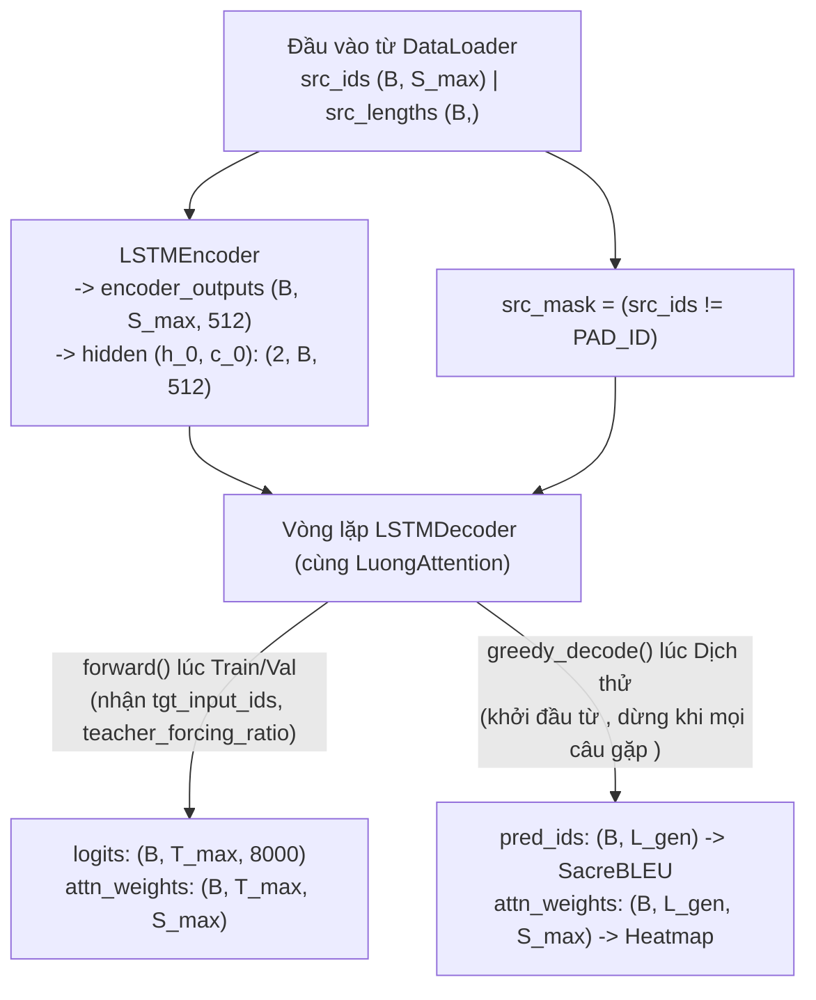

# Báo cáo Mô hình Hoàn chỉnh `Seq2SeqLSTM` — Đề tài 8: Dịch máy Anh–Việt

> **Tài liệu lưu trữ:** Bản nháp kỹ thuật tổng kết kiến trúc hoàn chỉnh Baseline **Seq2Seq LSTM + Luong Global Attention**, phục vụ soạn thảo Milestone Report (Tuần 3), Báo cáo cuối (Tuần 6) và ôn tập Vấn đáp cá nhân.  
> **Mã nguồn liên quan:** [`src/models/seq2seq_lstm/seq2seq.py`](../../src/models/seq2seq_lstm/seq2seq.py), [`tests/test_seq2seq_model.py`](../../tests/test_seq2seq_model.py)

---

## 1. Kiến trúc Ghép nối Hoàn chỉnh (`Seq2SeqLSTM` & `build_seq2seq_lstm`)

File [`src/models/seq2seq_lstm/seq2seq.py`](../../src/models/seq2seq_lstm/seq2seq.py) hoàn thiện mô hình Baseline của Giai đoạn 2 bằng cách ghép nối 3 khối [`LSTMEncoder`](../../src/models/seq2seq_lstm/encoder.py), [`LuongAttention`](../../src/models/seq2seq_lstm/attention.py) và [`LSTMDecoder`](../../src/models/seq2seq_lstm/decoder.py) thành một `nn.Module` thống nhất với hai luồng thực thi:



### 1.1. Bảo vệ khớp nối & Khởi tạo nhanh (`build_seq2seq_lstm`)
- Ngay trong `Seq2SeqLSTM.__init__`, mô hình kiểm tra chặt chẽ tính nhất quán giữa Encoder và Decoder:
  - `encoder.num_layers == decoder.num_layers`
  - `encoder.dec_hidden_dim == decoder.hidden_dim`
  - Nếu có Attention: `encoder.output_dim == decoder.enc_out_dim`
  - Đồng bộ `pad_id` giữa mô hình, Encoder và Decoder.
- Hàm factory `build_seq2seq_lstm(...)` cho phép khởi tạo 1 dòng duy nhất toàn bộ 4 biến thể phục vụ Baseline và Ablation Study (Tuần 4): `attention_method = "general"` (mặc định), `"dot"`, `"concat"`, hoặc `None` / `"none"`.

### 1.2. Hàm `forward` với Teacher Forcing & Scheduled Sampling
- Tạo tự động `src_mask = src_ids != self.pad_id`.
- Tham số `teacher_forcing_ratio` (`0.0 <= ratio <= 1.0`, mặc định `1.0`):
  - **Lúc `model.train()`**: Với xác suất `teacher_forcing_ratio`, bước $t+1$ dùng nhãn đúng `tgt_input_ids[:, t + 1]`; ngược lại dùng chính dự đoán trước đó `logits_t.argmax(dim=-1).detach()` (Scheduled Sampling nhằm giảm *Exposure Bias*).
  - **Lúc `model.eval()`**: Luôn khóa về Teacher Forcing chuẩn để tính Validation Loss nhất quán.

### 1.3. Hàm `greedy_decode` (Suy luận Tự hồi quy & Dừng sớm theo Batch)
- Chạy trong ngữ cảnh `@torch.no_grad()`, bắt đầu với toàn batch là `<bos> = 2`.
- Duy trì vector `finished` theo dõi riêng từng câu: câu nào vừa sinh ra `<eos> = 3` sẽ giữ nguyên trạng thái kết thúc và điền `<pad> = 0` cho các bước sau; vòng lặp tự động `break` sớm ngay khi tất cả câu trong batch đều gặp `<eos>` (hoặc chạm ngưỡng `max_len = 128`).
- Trả về `pred_ids (B, L_gen)` truyền thẳng được vào [`decode_and_compute_bleu`](../../src/evaluation/metrics.py) và `attn_weights (B, L_gen, S_max)` dùng để vẽ bản đồ nhiệt gióng hàng từ ở Tuần 5.

---

## 2. Thống kê Tham số qua 4 Biến thể (`IWSLT'15 En-Vi`, `vocab=8000`)

Trích xuất từ `python -m tests.test_seq2seq_model`:

| Chế độ `attention_method` | Encoder | Decoder Core | Attention | Tổng tham số |
| :--- | ---: | ---: | ---: | ---: |
| **`"general"`** *(Baseline mặc định)* | 5,202,944 | 10,355,008 | 262,144 | **15,820,096** |
| **`"dot"`** | 5,202,944 | 10,355,008 | 0 | **15,557,952** |
| **`"concat"`** (`attn_dim=256`) | 5,202,944 | 10,355,008 | 262,400 | **15,820,352** |
| **`None` / `"none"`** *(Không Attention)* | 5,202,944 | 9,830,208 | 0 | **15,033,152** |

---

## 3. Kết quả Kiểm thử Tự động & Overfit Smoke Test (`tests/test_seq2seq_model.py`)

Đã chạy kiểm định bằng cả `python -m tests.test_seq2seq_model` (5/5 test pass trong `9.674s`) và `pytest tests/test_seq2seq_model.py -v` (`5 passed in 10.15s`):

| Bài kiểm thử | Mục tiêu kiểm chứng | Kết quả |
| :--- | :--- | :---: |
| `test_factory_modes_and_mismatch_validation` | Kiểm tra khởi tạo đủ 4 chế độ (`general`, `dot`, `concat`, `None`/`"none"`), khớp chính xác tổng tham số và bắt lỗi `ValueError` khi Encoder/Decoder lệch số tầng hoặc số chiều | **PASS** |
| `test_forward_teacher_forcing_ratios` | Kiểm tra `forward` ở `teacher_forcing_ratio` = `1.0`, `0.5`, `0.0` (khi `train()`) và `eval()`, đảm bảo shape `(B, T_max, V)`, trọng số `<pad>` bằng `0.0` và tổng xác suất Attention bằng `1.0` | **PASS** |
| `test_greedy_decode_early_stop_and_bleu_integration` | Kiểm tra `greedy_decode` tự dừng khi gặp `<eos>`, điền `<pad>`, giới hạn `max_len`, chạy ở cả chế độ không Attention (`attn=None`) và nối thẳng sang `decode_and_compute_bleu` | **PASS** |
| `test_overfit_mini_batch_real_data` | **Chứng minh khả năng học thực tế:** Huấn luyện 30 bước (`Adam`, `lr=2e-2`, `clip_grad_norm_=1.0`) trên 4 câu thật từ `val` (`embed=64, hidden=64, 1 layer`): `Loss` giảm sâu xuống **dưới `1.5`** (giảm hơn **75%** so với bước đầu) và điểm **SacreBLEU** qua `greedy_decode` tăng rõ rệt | **PASS** |
| `test_full_baseline_15m_real_val_step` | Kiểm thử bản **Baseline Full (`15,820,096` tham số)** trên mini-batch 8 câu thật của `val` DataLoader: `Loss` khởi tạo hợp lệ quanh $\ln(8000) \approx 8.99$, mọi tham số đều có gradient hữu hạn sau `backward()`, `clip_grad_norm_(1.0)` và `Loss` giảm ở bước tiếp theo | **PASS** |

---

## 4. Lệnh chạy lại Kiểm thử

```bash
python -m tests.test_seq2seq_model
# Hoặc:
pytest tests/test_seq2seq_model.py -v
```
