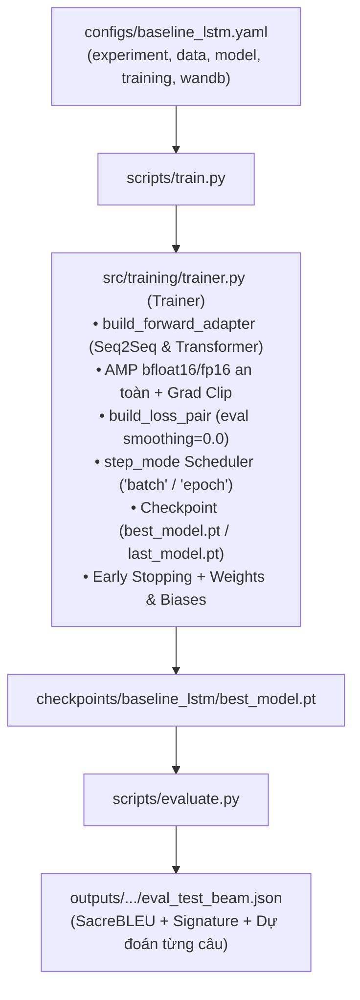

# Báo cáo Hạ tầng Huấn luyện, Checkpoint & Đánh giá CLI — Đề tài 8: Dịch máy Anh–Việt

> **Tài liệu lưu trữ:** Bản nháp kỹ thuật tổng kết **Chặng 3** (hoàn thiện trọn vẹn quy trình huấn luyện & đánh giá tự động cho Baseline Seq2Seq LSTM trên RTX 4060 GPU, dùng chung cho Transformer ở Tuần 3).  
> **Mã nguồn liên quan:** [`configs/baseline_lstm.yaml`](../../configs/baseline_lstm.yaml), [`src/training/trainer.py`](../../src/training/trainer.py), [`scripts/train.py`](../../scripts/train.py), [`scripts/evaluate.py`](../../scripts/evaluate.py), [`tests/test_trainer_and_scripts.py`](../../tests/test_trainer_and_scripts.py)

---

## 1. Kiến trúc Điều phối Khép kín (`Trainer` & CLI Scripts)



---

## 2. Xử lý 5 Chi tiết Kỹ thuật An toàn (Hardening) trong Chặng 3

1. **Chống tràn số AMP (`float16` / `bfloat16`) trong Attention & Trainer:**
   - Trong [`src/models/seq2seq_lstm/attention.py`](../../src/models/seq2seq_lstm/attention.py), phép chuẩn hóa `softmax` được ép tính ở `float32` (`torch.softmax(scores.float(), dim=-1).to(encoder_outputs.dtype)`) nhằm tránh sai số hoặc tràn biên ở nửa độ chính xác (`float16` tối đa `65,504`).
   - Trong `_resolve_amp_setup` của [`src/training/trainer.py`](../../src/training/trainer.py): khi `amp_dtype: auto`, GPU kiến trúc mới (như **RTX 4060**) tự chọn **`torch.bfloat16`** (dải số rộng tương đương `float32`, không cần `GradScaler`), còn GPU cũ dùng **`torch.float16`** kèm `GradScaler` (`unscale_` trước `clip_grad_norm_` và bỏ qua `NoamScheduler.step()` nếu AMP overflow). Khi chạy CPU, AMP tự động tắt an toàn.
2. **Hợp đồng `forward` dùng chung cho Seq2Seq LSTM & Transformer (`build_forward_adapter`):**
   - `Trainer` tự kiểm tra chữ ký hàm `model.forward` lúc khởi tạo: tự động truyền `src_lengths` và `teacher_forcing_ratio` cho `Seq2SeqLSTM`, đồng thời bỏ qua hai tham số này cho kiến trúc Transformer Tuần 3 (chỉ dùng `src_ids` và `tgt_input_ids`).
3. **Bảo toàn tuyệt đối trạng thái khi `--resume` (`save_checkpoint` & `load_checkpoint`):**
   - Tệp `last_model.pt` lưu đầy đủ `best_metric`, `best_epoch`, `early_stopping_counter`, `global_step`, `history`, `optimizer`, `scheduler`, `scaler` và `config`. Khi chạy tiếp với `--resume`, `best_metric` và bộ đếm Early Stopping được khôi phục nguyên vẹn, ngăn chặn ghi đè nhầm `best_model.pt` tốt hơn ở các Epoch trước.
4. **Khớp Gold Reference khi dùng `--max-val-batches` & tối ưu I/O Windows:**
   - `Trainer.validate` gọi `translate_dataloader(..., max_batches=max_batches)` nên danh sách câu tham chiếu gốc tự động cắt vừa đúng số câu đã giải mã (`gold_refs[:num_decoded]`).
   - Giữ `num_workers: 0` mặc định an toàn trên Windows và bổ sung `pin_memory` vào [`build_dataloaders`](../../src/data/dataset.py) (tự bật `True` khi phát hiện CUDA GPU).
5. **Chốt cấu hình Baseline & Workspace Weights & Biases (`configs/baseline_lstm.yaml`):**
   - **Siêu tham số huấn luyện:** `epochs: 20`, `lr: 0.001` (Adam), `grad_clip: 1.0`, `label_smoothing: 0.0`, `teacher_forcing_ratio: 1.0` (chuẩn Luong 2015 cho phép so sánh công bằng với Transformer ở Tuần 3; `0.5` / Scheduled Sampling để sang Ablation Tuần 4), `scheduler: plateau` (`factor=0.5, patience=2, min_lr=1e-6`), `early_stopping_patience: 5`, chọn `best_model.pt` theo **`val_bleu`**.
   - **Weights & Biases:** Liên kết sẵn với `entity: nikoteen-iai-uet`, `project: dich-may-Anh-Viet`; ghi cả các đường cong `train/val` Loss, PPL, BLEU, LR, grad_norm và bảng `val/samples` qua từng Epoch (có cờ `--no-wandb` để chạy offline/test).

---

## 3. Kết quả Kiểm thử Tự động (`tests/test_trainer_and_scripts.py` + Kiểm thử Hồi quy)

Đã chạy kiểm định đồng thời cả bộ test mới và các bộ test liên quan (`attention.py`, `decode.py`):
- `python -m tests.test_trainer_and_scripts`: **4 tests in `4.506s` $\rightarrow$ OK**
- `pytest tests/test_trainer_and_scripts.py tests/test_seq2seq_attention.py tests/test_decode.py -v`: **13 passed in `11.80s`**

| Bộ kiểm thử | Nội dung xác minh chính | Kết quả |
| :--- | :--- | :---: |
| `test_baseline_yaml_config_loads_and_builds_15m_model` | Đọc `configs/baseline_lstm.yaml`, khớp `entity=nikoteen-iai-uet`, `project=dich-may-Anh-Viet` và dựng đúng mô hình **15,820,096** tham số | **PASS** |
| `test_trainer_two_epochs_and_resume_preserves_best_metric_and_early_stopping` | Train 2 Epoch (`train_label_smoothing=0.1`, xác nhận `eval_loss_fn` giữ `0.0`), lưu `best_model.pt`/`last_model.pt`/`history.json`; khôi phục `best_metric=99.0` & `patience=2` sang Epoch 3 (`patience -> 3`, không ghi đè `best_model.pt`) | **PASS** |
| `test_early_stopping_triggers_on_stagnation` | Thiết lập `patience=2`, xác nhận `fit(num_epochs=6)` tự dừng đúng sau 2 Epoch không cải thiện | **PASS** |
| `test_evaluate_checkpoint_greedy_and_beam` | Nạp `best_model.pt` qua `evaluate_checkpoint` với `greedy` và `beam (k=2)`, kiểm tra file JSON xuất ra và câu tham chiếu gốc còn nguyên vẹn dấu `?` ở dòng 0 | **PASS** |
| Hồi quy `test_seq2seq_attention.py` & `test_decode.py` | Xác nhận 9/9 test của Attention (`float32` softmax) và Decoding (`Greedy`/`Beam`) đều hoạt động ổn định | **PASS (9/9)** |

---

## 4. Các Lệnh Chạy Thực tế trên Máy (Môi trường `learn_ai` có CUDA RTX 4060)

```bash
# 1. Chạy Smoke Test nhanh 1 Epoch với 5 batches trước khi train thật (tắt W&B)
python -m scripts.train --config configs/baseline_lstm.yaml --epochs 1 --max-train-batches 5 --max-val-batches 2 --no-wandb

# 2. Huấn luyện chính thức Baseline Seq2Seq LSTM + W&B trên RTX 4060
python -m scripts.train --config configs/baseline_lstm.yaml

# 3. Tiếp tục huấn luyện nếu bị gián đoạn giữa chừng
python -m scripts.train --config configs/baseline_lstm.yaml --resume checkpoints/baseline_lstm/last_model.pt

# 4. Đánh giá checkpoint tốt nhất trên tập Test bằng Beam Search (k=4, alpha=0.6)
python -m scripts.evaluate --checkpoint checkpoints/baseline_lstm/best_model.pt --split test --strategy beam --beam-size 4 --length-penalty 0.6
```
