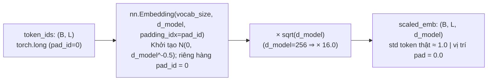

# Báo cáo Triển khai Tầng Nhúng Co giãn (`ScaledEmbedding`) — Đề tài 8: Dịch máy Anh–Việt

> **Tài liệu lưu trữ:** Bản nháp kỹ thuật cho thành phần `embeddings.py` trong **Giai đoạn 3 (Transformer từ đầu)**.  
> **Mã nguồn liên quan:** [`src/models/transformer/embeddings.py`](../../src/models/transformer/embeddings.py), [`src/models/transformer/__init__.py`](../../src/models/transformer/__init__.py), [`tests/test_transformer_positional_encoding.py`](../../tests/test_transformer_positional_encoding.py)

---

## 1. Vai trò & Hợp đồng Giao tiếp (`ScaledEmbedding`)

`ScaledEmbedding` chuyển đổi tensor chỉ số token đầu vào `token_ids` kích thước `(B, L)` (`torch.long`) sang biểu diễn vector đặc trưng liên tục kích thước `(B, L, d_model)` trước khi cộng với `SinusoidalPositionalEncoding`.

- **Chữ ký lớp:** `ScaledEmbedding(vocab_size: int, d_model: int, pad_id: int | None = PAD_ID)`
- **Quy mô tham số (cấu hình Transformer Small `vocab_size=8,000, d_model=256`):**
  - Mỗi tầng nhúng (Encoder nguồn Anh hoặc Decoder đích Việt) có đúng $8{,}000 \times 256 =$ **`2,048,000` tham số**.

---

## 2. Các Chi tiết Kỹ thuật Cốt lõi

1. **Khởi tạo chuẩn Transformer ($\mathcal{N}(0, d_{\text{model}}^{-1/2})$) và Co giãn $\sqrt{d_{\text{model}}}$ (Vaswani et al., 2017 – Mục 3.4):**
   - Bảng `self.embedding.weight` được khởi tạo theo phân phối chuẩn $\mathcal{N}(0, \sigma^2)$ với $\sigma = d_{\text{model}}^{-0.5}$ (khi `d_model = 256`, $\sigma = 1/16 = 0.0625$).
   - Khi đi qua `forward`, kết quả tra bảng được nhân với hệ số `self.scale = math.sqrt(d_model)` ($\times 16$).
   - **Tác dụng kép:**
     - Độ lệch chuẩn đầu ra của các token thật trở về **$\approx 1.0$** (đo thực tế trên batch kiểm thử với `vocab_size=8000, d_model=256`: **`0.9995`**), cân bằng biên độ với giá trị `[-1, 1]` của Positional Encoding để thông tin ngữ nghĩa từ không bị tín hiệu vị trí lấn át.
     - Vẫn tương thích nếu mô hình về sau muốn chia sẻ trọng số (*Weight Tying*) giữa lớp Embedding và lớp chiếu từ vựng đầu ra `fc_out` (nếu dùng chung bảng trọng số ở Decoder).
2. **Bảo toàn tuyệt đối Vector & Gradient cho `pad_id = 0`:**
   - Lời gọi `nn.init.normal_` ghi đè toàn bộ ma trận trọng số, nên ngay sau khi khởi tạo phải reset riêng hàng `pad_id` về `0.0` trong khối `with torch.no_grad(): self.embedding.weight[self.pad_id].zero_()`.
   - Truyền `padding_idx=pad_id` vào `nn.Embedding` giúp PyTorch khóa gradient của hàng `pad_id = 0` luôn bằng `0.0` qua suốt mọi bước cập nhật `backward()`.
3. **Kiểm tra hợp lệ đầu vào (Input Validation):**
   - Ném `ValueError` ngay khi khởi tạo nếu `vocab_size <= 0`, `d_model <= 0`, hoặc `pad_id` nằm ngoài `[0, vocab_size - 1]`.

---

## 3. Kết quả Kiểm thử Tự động (Trích từ [`tests/test_transformer_positional_encoding.py`](../../tests/test_transformer_positional_encoding.py))

Kiểm chứng trong môi trường `learn_ai` (**6/6 tests PASS** trong `0.599s` với `unittest` / `2.06s` với `pytest`):

| Hạng mục kiểm thử | Điều kiện & Giá trị đo được | Kết quả |
| :--- | :--- | :---: |
| **Validate tham số khởi tạo** | Bắt đúng `ValueError` khi `vocab_size=0`, `d_model=0`, `pad_id=100`, `pad_id=-1` | **PASS** |
| **Vector `pad_id = 0` trước khi cộng PE** | Toàn bộ phần tử tại vị trí `tokens == 0` có giá trị chính xác bằng `0.0` | **PASS** |
| **Độ lệch chuẩn đầu ra token thật** | Đo trên `ScaledEmbedding(8000, 256)` với `seed=42`: **`std = 0.9995`** (nằm gọn trong `[0.85, 1.15]`) | **PASS** |
| **Gradient hàng `pad_id = 0` sau `backward()`** | `emb.embedding.weight.grad[0]` bằng đúng `0.0`; các token thật có gradient hữu hạn $> 0$ | **PASS** |
| **Tích hợp trên batch thật `data/processed/val.en`** | Chạy qua `DataLoader` (`batch_size=8, max_len=128`), kiểm tra shape `(8, S_max, 256)`, `pad=0` và `backward()` sạch | **PASS** |
