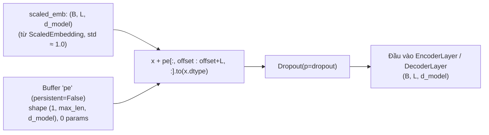

# Báo cáo Triển khai `SinusoidalPositionalEncoding` — Đề tài 8: Dịch máy Anh–Việt

> **Tài liệu lưu trữ:** Bản nháp kỹ thuật cho thành phần `positional_encoding.py` trong **Giai đoạn 3 (Transformer từ đầu)**.  
> **Mã nguồn liên quan:** [`src/models/transformer/positional_encoding.py`](../../src/models/transformer/positional_encoding.py), [`src/models/transformer/__init__.py`](../../src/models/transformer/__init__.py), [`tests/test_transformer_positional_encoding.py`](../../tests/test_transformer_positional_encoding.py)

---

## 1. Động lực & Công thức Toán học (`SinusoidalPositionalEncoding`)

Khác với Seq2Seq LSTM đọc chuỗi tuần tự từng bước $t = 1 \rightarrow L$, cơ chế **Self-Attention** trong Transformer xử lý **song song toàn bộ $L$ vị trí cùng lúc**, nên tự thân nó bất biến theo hoán vị (*permutation-invariant*). `SinusoidalPositionalEncoding` bơm tín hiệu vị trí tuyệt đối và tương đối vào đầu ra của [`ScaledEmbedding`](../../src/models/transformer/embeddings.py):

- **Công thức (Vaswani et al., 2017 – Mục 3.5):**
  $$PE_{(pos, 2i)} = \sin\!\left(\frac{pos}{10000^{2i / d_{\text{model}}}}\right), \qquad PE_{(pos, 2i+1)} = \cos\!\left(\frac{pos}{10000^{2i / d_{\text{model}}}}\right)$$
  - Tính `div_term` trong không gian log với `dtype=torch.float32` tường minh:
    `torch.exp(torch.arange(0, d_model, 2, dtype=torch.float32) * (-math.log(10000.0) / d_model))`
  - **Tính chất xoay tuyến tính theo vị trí tương đối:** Với mọi độ dịch cố định $k$, tồn tại ma trận xoay $2 \times 2$ $M_k$ chỉ phụ thuộc vào $k$ và tần số $\omega_i$ (không phụ thuộc vào $pos$) sao cho $M_k \cdot PE_{pos} = PE_{pos + k}$, giúp Self-Attention học được quan hệ khoảng cách tương đối giữa các từ.

---

## 2. Thiết kế Kỹ thuật & Quy ước Giao diện

- **Lớp chính:** `SinusoidalPositionalEncoding(d_model: int, dropout: float = 0.1, max_len: int = 512)` (export kèm alias `PositionalEncoding` qua [`src/models/transformer/__init__.py`](../../src/models/transformer/__init__.py)).
- **5 điểm thiết kế trọng tâm:**
  1. **Buffer `persistent=False` (`0` tham số huấn luyện):** Đăng ký `self.register_buffer("pe", pe.unsqueeze(0), persistent=False)` shape `(1, max_len, d_model)` giúp bảng `pe` tự đi theo `.to(device)` sang GPU, không tiêu tốn gradient, và **không đóng cứng vào `state_dict()`** để có thể nạp checkpoint sang một giá trị `max_len` lớn hơn lúc suy luận mà không bị lỗi lệch kích thước.
  2. **Hỗ trợ `offset >= 0` (`forward(x, offset=0)`):** Mặc định `offset=0` cắt đoạn `pe[:, :L, :]` khi chạy song song; khi giải mã tăng dần từng token (`L=1`), truyền `offset=t` để cộng đúng vector tại vị trí $t$.
  3. **An toàn với AMP (`bfloat16` / `float16`):** Bảng `pe` luôn tính ở `torch.float32` rồi ép `.to(dtype=x.dtype)` ngay lúc cộng vào `x`, tương thích trọn vẹn với huấn luyện `bfloat16` trên RTX 4060.
  4. **Dropout tham số hóa:** Áp dụng `nn.Dropout(p=dropout)` ngay sau phép cộng `x + pos_emb` theo đúng bài báo gốc (không hardcode; cấu hình Transformer Small sẽ truyền `dropout=0.2`).
  5. **Siết chặt kiểm tra biên (`ValueError`):** Bắt lỗi rõ ràng khi `d_model <= 0` hoặc lẻ, `max_len <= 0`, `dropout` ngoài `[0.0, 1.0)`, `x.dim() != 3`, `x.size(-1) != d_model`, `offset < 0`, hoặc `offset + seq_len > max_len`.

---

## 3. Kết quả Kiểm thử Tự động ([`tests/test_transformer_positional_encoding.py`](../../tests/test_transformer_positional_encoding.py))

Kiểm chứng trong môi trường `learn_ai` (GPU **RTX 4060 CUDA = True**):
- `python -m tests.test_transformer_positional_encoding`: **Ran 6 tests in `0.599s` $\rightarrow$ OK**
- `pytest tests/test_transformer_positional_encoding.py -v`: **6 passed in `2.06s`**

| Ca kiểm thử | Nội dung xác minh chính | Kết quả |
| :--- | :--- | :---: |
| `test_shape_persistent_false_buffer_and_zero_trainable_params` | Output `(4, L, 256)` với `L ∈ {1, 16, 128}`, **`0` tham số huấn luyện**, `"pe"` nằm trong `named_buffers()` nhưng vắng mặt trong `state_dict()`, load sang `max_len=1024` thành công | **PASS** |
| `test_exact_sinusoidal_formula_and_value_bounds` | Tại `pos=0` cột chẵn `0.0` / cột lẻ `1.0`; khớp giải tích tại nhiều `(pos, i)` (`atol=1e-5`); mọi giá trị hữu hạn trong `[-1, 1]` | **PASS** |
| `test_relative_position_linear_rotation_property` | Chứng minh bằng số phép xoay $M_k \cdot PE_{pos} = PE_{pos+k}$ ($k \in \{3, 17\}$, $pos \in \{0, 5, 42\}$, `atol=1e-5`) | **PASS** |
| `test_offset_dropout_amp_bfloat16_and_validation_errors` | `offset=t` khớp chuỗi đầy đủ, `dropout=0.2` hoạt động đúng ở `train`/`eval`, giữ nguyên `torch.bfloat16` trên CPU & CUDA, bắt đủ 11 trường hợp `ValueError` của PE | **PASS** |
| `test_scaled_embedding_and_pe_integration_with_padding_and_gradients` | Phối hợp `ScaledEmbedding -> SinusoidalPositionalEncoding` giữ `pad=0` và `grad[0]=0.0` sau `backward()` | **PASS** |
| `test_real_val_batch_integration_optional` | Tích hợp trực tiếp với `DataLoader` trên batch thật `data/processed/val.en` (có `skipTest` khi thiếu dữ liệu ngoài) | **PASS** |
