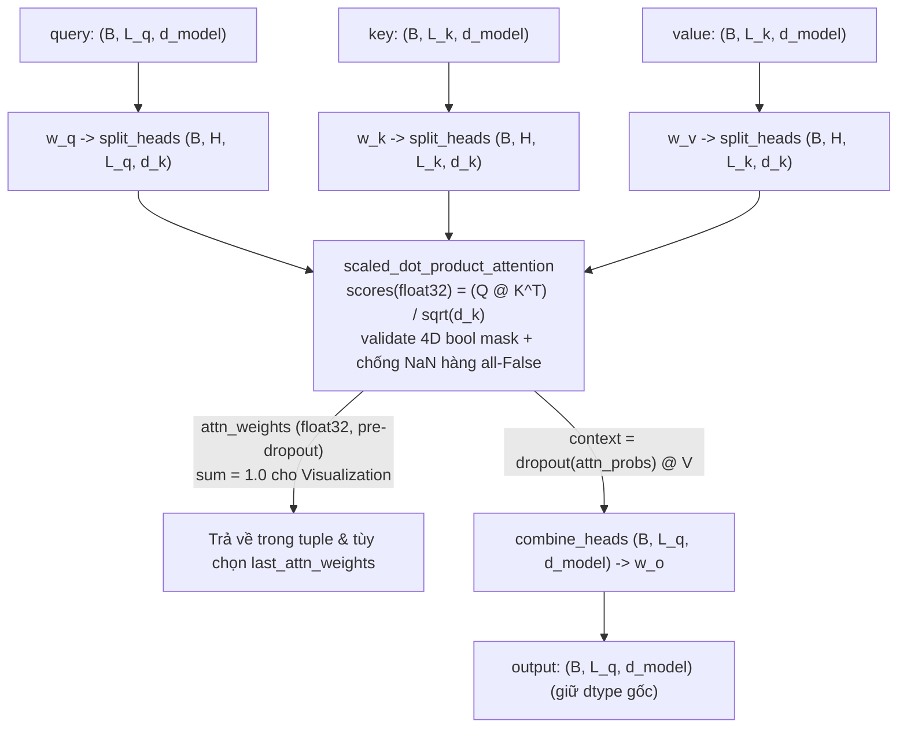

# Báo cáo Triển khai Scaled Dot-Product & Multi-Head Attention — Đề tài 8: Dịch máy Anh–Việt

> **Tài liệu lưu trữ:** Bản nháp kỹ thuật tổng kết **Công việc 2/5 – Đầu việc 1 (Giai đoạn 3)**: tự cài đặt `scaled_dot_product_attention` và `MultiHeadAttention` dùng chung cho cả 3 vị trí trong Transformer (không dùng `nn.MultiheadAttention` hay `F.scaled_dot_product_attention`).  
> **Mã nguồn liên quan:** [`src/models/transformer/attention.py`](../../src/models/transformer/attention.py), [`src/models/transformer/__init__.py`](../../src/models/transformer/__init__.py), [`tests/test_transformer_attention.py`](../../tests/test_transformer_attention.py)

---

## 1. Kiến trúc Dùng chung cho cả 3 Vị trí trong Transformer

Cơ chế **Multi-Head Attention** cho phép mô hình đồng thời chú ý tới thông tin ở **nhiều không gian biểu diễn con (representation subspaces)** khác nhau (chẳng hạn head theo dõi quan hệ chủ–vị, head theo dõi giới từ, head theo dõi cụm danh từ). Chỉ bằng một lớp `MultiHeadAttention` duy nhất, toàn bộ Transformer tái sử dụng linh hoạt cho cả 3 vai trò:

| Vị trí trong Transformer | Đầu vào `(query, key, value)` | Mask truyền vào | Kích thước `attn_weights` |
| :--- | :--- | :--- | :---: |
| **1. Encoder Self-Attention** | `(enc_x, enc_x, enc_x)` | `src_mask` `(B, 1, 1, S)` | `(B, H, S, S)` |
| **2. Decoder Masked Self-Attention** | `(dec_x, dec_x, dec_x)` | `tgt_mask` `(B, 1, T, T)` *(Padding + Causal)* | `(B, H, T, T)` |
| **3. Decoder Cross-Attention** | `(dec_x, enc_out, enc_out)` | `src_mask` `(B, 1, 1, S)` | `(B, H, T, S)` |

---

## 2. Công thức & Các quyết định An toàn Kỹ thuật

### 2.1. `scaled_dot_product_attention` (Vaswani et al., 2017 – Mục 3.2.1)
$$\text{Attention}(Q, K, V) = \text{softmax}\!\left(\frac{QK^\top}{\sqrt{d_k}}\right) V$$

Được tự cài đặt hoàn toàn bằng `torch.matmul` và `F.softmax` với **5 điểm an toàn**:
1. **Quy ước `torch.bool` nhất quán với Baseline Seq2Seq LSTM:** `True` = vị trí hợp lệ (được phép chú ý), `False` = vị trí bị che (`<pad>` hoặc token tương lai $\rightarrow$ `-inf`).
2. **Bắt buộc `mask.ndim == 4`:** Nếu truyền nhầm mask 2D `(B, L_k)` hoặc 3D `(B, L_q, L_k)`, hàm ném ngay `ValueError` thay vì để PyTorch tự broadcast sai trục (đặc biệt nguy hiểm khi `B == L_q`).
3. **Chống `NaN` ở hàng bị mask toàn bộ (`all-False`):** Tính `all_masked = ~mask.any(dim=-1, keepdim=True)`, thay tạm hàng toàn `-inf` thành `0.0` trước `F.softmax`, rồi `masked_fill(all_masked, 0.0)` sau `softmax` $\rightarrow$ chỉ chạy 1 lần `softmax`, trả về `0.0` sạch không có `NaN` ở cả `forward()` lẫn `backward()`.
4. **Ổn định AMP (`bfloat16` / `float16`) & Độ chính xác trực quan hóa:** Phép nhân chia `scores` và `F.softmax` luôn tính ở **`torch.float32`**. Trọng số `attn_weights` trả về giữ nguyên ở `float32` (tổng hàng chính xác `1.0`, chưa bị dropout làm méo), còn `context` và `output` được ép về đúng `dtype` gốc (ví dụ `bfloat16` trên RTX 4060).
5. **Dropout đúng chuẩn bài báo:** `self.attn_dropout` chỉ áp dụng lên `attn_probs` ngay trước phép nhân `V`, không làm biến dạng `attn_weights` dùng vẽ Attention Heatmap ở Tuần 5.

### 2.2. `MultiHeadAttention`
- **4 lớp chiếu tuyến tính (`w_q`, `w_k`, `w_v`, `w_o`):** Khởi tạo **Xavier Uniform** (`bias = 0.0`). Với cấu hình Transformer Small (`d_model=256, num_heads=4` $\Rightarrow$ `d_k=64`, `bias=True`), mỗi block có đúng $4 \times (256 \times 256 + 256) =$ **`263,168` tham số**.
- **Quản lý VRAM (`store_attn: bool = False`):** Khi `store_attn=True`, lưu `self.last_attn_weights = attn_weights.detach()`; khi tắt (`False`), gán tường minh `self.last_attn_weights = None` để không giữ lại tensor cũ trong VRAM khi train.

---

## 3. Kết quả Kiểm thử Tự động ([`tests/test_transformer_attention.py`](../../tests/test_transformer_attention.py))

Kiểm chứng trong môi trường `learn_ai` (cả CPU & GPU **RTX 4060 CUDA**):
- `python -m tests.test_transformer_attention`: **Ran 6 tests in `0.622s` $\rightarrow$ OK**
- `pytest tests/test_transformer_attention.py tests/test_transformer_positional_encoding.py -v`: **12 passed in `2.09s`**

| Ca kiểm thử | Nội dung xác minh chính | Kết quả |
| :--- | :--- | :---: |
| `test_scaled_dot_product_attention_exact_formula_and_scaling` | Khớp giải tích `atol=1e-6`, tổng hàng `1.0`, xác minh chia $\sqrt{256}$ giữ `std(scores) ≈ 1.0` | **PASS** |
| `test_three_attention_roles_and_pad_invariance` | Xác nhận cả **3 vai trò** (Encoder Self, Decoder Masked Self, Cross-Attention); đổi `<pad>` lên `±1e5` không làm đổi output thật; sửa token tương lai không rò rỉ về quá khứ | **PASS** |
| `test_all_masked_row_no_nan_in_forward_and_backward` | Hàng hoặc cả câu bị mask toàn bộ ra đúng `0.0`, 0 `NaN/Inf` ở forward và `q/k/v.grad` | **PASS** |
| `test_param_count_store_attn_dropout_and_amp_bfloat16` | Đúng **`263,168` params**, `store_attn=False` xóa sạch `last_attn_weights = None`, `output` giữ `bfloat16` trên CPU & CUDA còn `attn_weights` giữ `float32` (tổng = `1.0`) | **PASS** |
| `test_validation_errors` | Bắt đủ lỗi cấu hình, mask 2D/3D khi `B == L_q`, mask `float32`, lệch head, lệch batch, `L_k != L_v` | **PASS** |
| `test_end_to_end_embedding_pe_mha_gradients_and_optional_val_batch` | Nối chuỗi `ScaledEmbedding -> PE -> Self/Cross MHA`, xác minh cả `w_q, w_k, w_v, w_o` (weight & bias) có gradient hữu hạn khác `0`, `emb.grad[0] == 0.0`, chạy sạch trên batch thật `val` | **PASS** |
