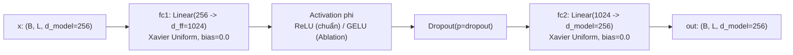

# Báo cáo Triển khai Mạng Feed-Forward theo Vị trí (`PositionWiseFeedForward`) — Đề tài 8: Dịch máy Anh–Việt

> **Tài liệu lưu trữ:** Bản nháp kỹ thuật tổng kết **Công việc 3/5 – Đầu việc 1 (Giai đoạn 3)**: tách riêng và cài đặt mạng `PositionWiseFeedForward` cho cả các lớp `EncoderLayer` và `DecoderLayer` của Transformer.  
> **Mã nguồn liên quan:** [`src/models/transformer/feed_forward.py`](../../src/models/transformer/feed_forward.py), [`src/models/transformer/__init__.py`](../../src/models/transformer/__init__.py), [`tests/test_transformer_feed_forward.py`](../../tests/test_transformer_feed_forward.py)

---

## 1. Vai trò & Công thức Toán học (`PositionWiseFeedForward`)

Nếu tầng **Multi-Head Attention** chịu trách nhiệm **trộn thông tin giữa các vị trí từ khác nhau** (*token mixing*), thì `PositionWiseFeedForward` đứng ngay sau đó để **xử lý phi tuyến độc lập trên từng vị trí từ** (*channel mixing*):

$$\text{FFN}(x) = W_2 \Big(\text{Dropout}\big(\phi(W_1 x + b_1)\big)\Big) + b_2$$

- **Tính chất *Position-wise*:** Cùng một cặp ma trận trọng số $(W_1, W_2)$ được áp dụng song song và **hoàn toàn độc lập** cho mỗi token $t \in \{0, \dots, L-1\}$ (tương đương về mặt toán học với hai tầng tích chập `Conv1d` có `kernel_size = 1`). Nhờ vậy, giá trị của token tại vị trí $t_2$ hoàn toàn không làm thay đổi đầu ra FFN tại vị trí $t_1 \ne t_2$.

---

## 2. Quyết định Thiết kế Kỹ thuật

- **Chữ ký lớp:** `PositionWiseFeedForward(d_model, d_ff, dropout=0.1, activation="relu", bias=True)`
  - Với cấu hình **Transformer Small** (`d_model=256, d_ff=1024, bias=True`), mỗi khối FFN có $(256 \times 1{,}024 + 1{,}024) + (1{,}024 \times 256 + 256) =$ **`525,568` tham số** (hoặc **`524,288`** tham số khi `bias=False`).
- **Khởi tạo trọng số đồng bộ:** Cả `fc1` và `fc2` đều dùng **`xavier_uniform_`** và đặt `bias = 0.0` (kèm kiểm tra `if layer.bias is not None:` để an toàn khi chạy `bias=False`), đồng nhất hoàn toàn với [`MultiHeadAttention`](../../src/models/transformer/attention.py) và đảm bảo phép so sánh công bằng khi khảo sát **`relu` vs `gelu`** ở Tuần 4.
- **Mở rộng hàm kích hoạt linh hoạt:** Hỗ trợ `"relu"` (mặc định theo Vaswani et al., 2017) và `"gelu"` (không phân biệt hoa/thường), ném `ValueError` rõ ràng nếu truyền tên không hợp lệ.
- **Tương thích AMP & Kiểm tra biên:** Chạy trực tiếp trên `torch.bfloat16` (CPU & RTX 4060 CUDA), bắt `ValueError` khi `d_model <= 0`, `d_ff <= 0`, `dropout` ngoài `[0.0, 1.0)`, hoặc `x` không phải tensor 3D `(B, L, d_model)`.

---

## 3. Kết quả Kiểm thử Tự động ([`tests/test_transformer_feed_forward.py`](../../tests/test_transformer_feed_forward.py))

Kiểm chứng trong môi trường `learn_ai` (cả CPU `float32` & GPU **RTX 4060 CUDA `bfloat16`**):
- `python -m tests.test_transformer_feed_forward`: **Ran 5 tests in `0.378s` $\rightarrow$ OK**
- `pytest tests/test_transformer_feed_forward.py tests/test_transformer_attention.py tests/test_transformer_positional_encoding.py -v`: **17 passed in `2.23s`**

| Ca kiểm thử | Nội dung xác minh chính | Kết quả |
| :--- | :--- | :---: |
| `test_shape_and_param_count_with_and_without_bias` | Kiểm tra output `(4, 16, 256)`, đúng **`525,568`** params (`bias=True`) và **`524,288`** params (`bias=False`, `fc1.bias/fc2.bias is None`) | **PASS** |
| `test_exact_formula_relu_and_gelu` | Đối chiếu giải tích `F.linear(act(F.linear(...)))` cho cả `"ReLU"` và `"GELU"` (`atol=1e-6`) | **PASS** |
| `test_position_wise_independence_on_cpu_float32` | Chạy trên **CPU `float32`** (tránh sai số làm tròn TF32 GPU), nhiễu `+1e5` ở vị trí `t=3` không làm đổi mọi vị trí khác từng bit (`torch.equal`) | **PASS** |
| `test_dropout_amp_bfloat16_and_validation_errors` | Xác nhận `dropout=0.2` (`train` vs `eval`), giữ nguyên `torch.bfloat16` trên CPU & CUDA RTX 4060, bắt đủ 10 trường hợp `ValueError` | **PASS** |
| `test_end_to_end_pipeline_gradients_and_optional_val_batch` | Chạy chuỗi `ScaledEmbedding -> PE -> MHA -> FFN` trên batch giả lập và batch thật `val.en`, xác minh `fc1`/`fc2` có gradient hữu hạn khác `0` và `emb.grad[0] == 0.0` | **PASS** |
