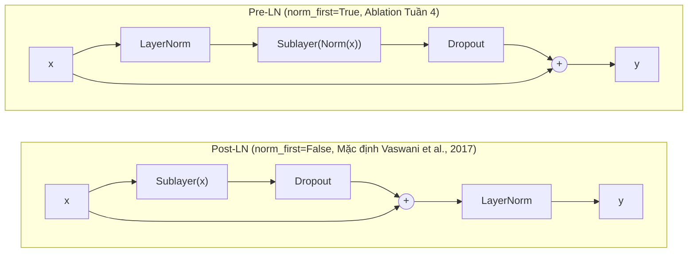

# Báo cáo Triển khai Residual Connection & LayerNorm (`SublayerConnection`) — Đề tài 8: Dịch máy Anh–Việt

> **Tài liệu lưu trữ:** Bản nháp kỹ thuật tổng kết **Công việc 4/5 – Đầu việc 1 (Giai đoạn 3)**: cài đặt `SublayerConnection` (Residual Connection + LayerNorm + Dropout, hỗ trợ cả **Post-LN** mặc định và **Pre-LN** phục vụ đối chứng) dùng chung cho các tầng con của Transformer.  
> **Mã nguồn liên quan:** [`src/models/transformer/layers.py`](../../src/models/transformer/layers.py), [`src/models/transformer/__init__.py`](../../src/models/transformer/__init__.py), [`tests/test_transformer_layers.py`](../../tests/test_transformer_layers.py)

---

## 1. Vai trò & Hai Chế độ Chuẩn hóa (`Post-LN` vs `Pre-LN`)

Để huấn luyện được các khối Transformer sâu gồm nhiều tầng `MultiHeadAttention` và `PositionWiseFeedForward` xếp chồng, mỗi sublayer cần kết hợp **Kết nối tắt (Residual Connection)** và **Chuẩn hóa theo lớp (Layer Normalization)**:

- **Post-LN (`norm_first=False`, mặc định):**
  $$y = \text{LayerNorm}\Big(x + \text{Dropout}\big(\text{Sublayer}(x)\big)\Big)$$
  Giữ đúng kiến trúc nguyên bản *Attention Is All You Need* (Vaswani et al., 2017) làm cấu hình huấn luyện chuẩn ban đầu (cần warmup với `NoamScheduler`).
- **Pre-LN (`norm_first=True`, đối chứng Tuần 4):**
  $$y = x + \text{Dropout}\Big(\text{Sublayer}\big(\text{LayerNorm}(x)\big)\Big)$$
  Đường residual chính ($x \to y$) hoàn toàn sạch (không đi qua `LayerNorm` hay `Dropout`), tạo đường dẫn gradient trực tiếp giúp ổn định hội tụ hơn. *(Lưu ý cho Công việc 5: khi xếp chồng nhiều lớp Pre-LN trong `Encoder`/`Decoder`, cần thêm một lớp `final_norm = nn.LayerNorm(d_model)` ở đầu ra cuối cùng của stack.)*

---

## 2. Quyết định Thiết kế Kỹ thuật

- **Chữ ký lớp:** `SublayerConnection(d_model: int, dropout: float = 0.1, norm_first: bool = False, eps: float = 1e-5)`
  - Sử dụng `nn.LayerNorm(d_model, eps=eps)` chuẩn PyTorch (tự tính mean/variance ở `float32` nên an toàn số học dưới AMP `bfloat16`/`fp16`). Với `d_model=256`, mỗi `SublayerConnection` có đúng **`512` tham số** (`norm.weight = 1.0`, `norm.bias = 0.0`).
  - `Dropout` chỉ áp dụng lên đầu ra `sublayer(...)` **trước phép cộng residual**, tuyệt đối không đặt lên nhánh tắt `x`.
- **Kiểm tra hợp đồng đầu vào/đầu ra (Defensive Validation):**
  - Chặn truyền nhầm kiểu cho `norm_first` (`isinstance(norm_first, bool)`) để tránh lỗi Python đánh giá chuỗi `"post"` thành `True`.
  - Kiểm tra `x` là tensor 3D `(B, L, d_model)`, `callable(sublayer)`, đầu ra `sublayer_out` phải là đúng một `torch.Tensor` *(bắt sớm lỗi nếu lỡ truyền trực tiếp `MultiHeadAttention` vốn trả về tuple `(output, attn_weights)`)* và khớp `sublayer_out.shape == x.shape` *(tránh broadcast sai ngầm)*.
- **Export gói module:** Đã export `SublayerConnection` trong [`src/models/transformer/__init__.py`](../../src/models/transformer/__init__.py).

---

## 3. Kết quả Kiểm thử Tự động ([`tests/test_transformer_layers.py`](../../tests/test_transformer_layers.py))

Kiểm chứng trong môi trường `learn_ai` (CPU `float32` & GPU `bfloat16` CUDA):
- `python -m tests.test_transformer_layers`: **Ran 5 tests in `1.244s` $\rightarrow$ OK**
- `pytest tests/test_transformer_layers.py tests/test_transformer_feed_forward.py tests/test_transformer_attention.py tests/test_transformer_positional_encoding.py -v`: **22 passed in `3.17s`**

| Ca kiểm thử | Nội dung xác minh chính | Kết quả |
| :--- | :--- | :---: |
| `test_default_post_ln_params_init_and_zero_sublayer_behavior` | Mặc định `norm_first=False`, `512` params; với `sublayer = torch.zeros_like`, Pre-LN ở cả `eval()` lẫn `train(dropout=0.2)` vẫn `torch.equal(..., x)` (Dropout không chạm nhánh tắt), còn Post-LN chuẩn hóa `mean ≈ 0`, `var ≈ 1` | **PASS** |
| `test_exact_formula_pre_ln_vs_post_ln_and_position_independence_cpu_float32` | Đối chiếu giải tích `x + ffn(norm(x))` vs `norm(x + ffn(x))` (`atol=1e-6`); kiểm tra trên CPU `float32` nhiễu `+1e5` ở `t=2` không đổi bit các vị trí khác (`torch.equal`) | **PASS** |
| `test_dropout_amp_bfloat16_and_validation_errors` | Xác nhận `dropout=0.2` (`train` vs `eval`), giữ nguyên `torch.bfloat16` và hữu hạn với biên độ `100×` trên CPU & CUDA, bắt đủ `ValueError`/`TypeError` (bao gồm nhầm tuple MHA và `norm_first="post"`) | **PASS** |
| `test_gradient_flow_pre_ln_and_post_ln` | Gradient hữu hạn khác `0` qua `MHA` + `FFN` ở cả 2 chế độ; riêng Pre-LN (`zeros_like`) xác nhận `x.grad == grad_out` (`atol=1e-6`) | **PASS** |
| `test_end_to_end_encoder_block_pipeline_and_optional_val_batch` | Nối chuỗi `ScaledEmbedding -> PE -> Sublayer(MHA) -> Sublayer(FFN)` trên batch giả lập & batch thật `val.en` cho cả Post-LN và Pre-LN; `emb.grad[0] == 0.0` | **PASS** |
