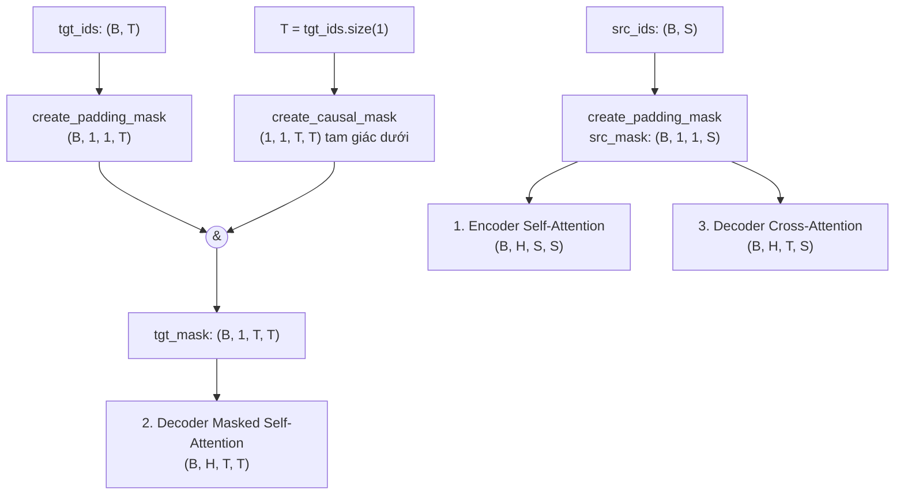

# Báo cáo Triển khai Bộ tạo Mặt nạ Attention (`masks.py`) — Đề tài 8: Dịch máy Anh–Việt

> **Tài liệu lưu trữ:** Bản nháp kỹ thuật cho **Đầu việc 2 – Giai đoạn 3**: cài đặt Padding Mask & Causal Look-Ahead Mask (`src/models/transformer/masks.py`), đồng bộ quy ước boolean 4D với [`MultiHeadAttention`](../../src/models/transformer/attention.py) và `PAD_ID = 0`.  
> **Mã nguồn liên quan:** [`src/models/transformer/masks.py`](../../src/models/transformer/masks.py), [`src/models/transformer/__init__.py`](../../src/models/transformer/__init__.py), [`tests/test_transformer_masks.py`](../../tests/test_transformer_masks.py)

---

## 1. Quy ước & Kiến trúc Broadcast 4D (`True = giữ`, `False = che`)

Tất cả các hàm tạo mặt nạ trả về tensor **`torch.bool`** 4 chiều để broadcast trực tiếp vào ma trận điểm số `scores` kích thước `(B, H, L_q, L_k)` trong `scaled_dot_product_attention`:

| Hàm công khai | Đầu vào | Shape đầu ra | Công dụng chính |
| :--- | :--- | :---: | :--- |
| `create_padding_mask(token_ids, pad_id=PAD_ID)` | `(B, L)` nguyên | `(B, 1, 1, L)` | Che cột `<pad>` cho Encoder Self-Attention & Decoder Cross-Attention |
| `create_causal_mask(seq_len, device=None)` | `seq_len > 0` | `(1, 1, T, T)` | Tam giác dưới (`j <= i`) ngăn rò rỉ token tương lai |
| `create_target_mask(tgt_ids, pad_id=PAD_ID)` | `(B, T)` nguyên | `(B, 1, T, T)` | Phép giao Padding Mask theo Key `&` Causal Mask cho Decoder Self-Attention |
| `create_masks(src_ids, tgt_ids, pad_id=PAD_ID)` | `(B, S), (B, T)` | `((B,1,1,S), (B,1,T,T))` | Gọi 1 lần tạo trọn bộ `src_mask, tgt_mask` cho `Transformer.forward()` |

---

## 2. Quyết định Thiết kế & Validation Biên

- **Import sạch `PAD_ID`:** Import trực tiếp `from src.data.tokenizer import PAD_ID` (giống [`embeddings.py`](../../src/models/transformer/embeddings.py)), không gây circular import.
- **Validation chặt chẽ:**
  - Chặn batch rỗng (`B == 0`), chuỗi rỗng (`L == 0`), tensor khác 2D.
  - Chặn nghiêm ngặt mọi dtype không phải số nguyên (bao gồm `float`, `bool`, `complex64`, `complex128`) thông qua whitelist `_INTEGER_DTYPES`.
  - Dùng `not isinstance(..., int) or isinstance(..., bool)` cho cả `seq_len` và `pad_id` để ngăn lọt `float`/`bool`.
  - Kiểm tra khớp `batch_size` và cùng `device` giữa `src_ids` và `tgt_ids` trong `create_masks`.
- **Export gói module:** Đã export cả 4 hàm trong [`src/models/transformer/__init__.py`](../../src/models/transformer/__init__.py).

---

## 3. Kết quả Kiểm thử Tự động ([`tests/test_transformer_masks.py`](../../tests/test_transformer_masks.py))

Kiểm chứng trong môi trường `learn_ai` (CPU `float32` & GPU `bfloat16` CUDA):
- `python -m tests.test_transformer_masks`: **Ran 5 tests in `1.053s` $\rightarrow$ OK**
- `pytest tests/test_transformer_masks.py tests/test_transformer_layers.py tests/test_transformer_feed_forward.py tests/test_transformer_attention.py tests/test_transformer_positional_encoding.py -v`: **27 passed in `4.35s`**

| Ca kiểm thử | Nội dung xác minh chính | Kết quả |
| :--- | :--- | :---: |
| `test_create_padding_mask_shapes_values_and_custom_pad_id` | Xác minh shape `(B, 1, 1, S)`, `torch.bool`, câu không pad / pad cuối / toàn pad và `pad_id=99` | **PASS** |
| `test_create_causal_mask_lower_triangular_and_device` | Xác minh `T=1`, ma trận `T=6` thỏa `j <= i` ở mọi phần tử và tạo trực tiếp trên `cuda` | **PASS** |
| `test_create_target_mask_create_masks_and_validation_errors` | Xác minh phép giao `(j <= i) and (tgt[b, j] != pad_id)` với `S != T`, bắt đủ lỗi `B == 0`, `L == 0`, `complex`, `float`, `bool`, lệch `B`/`device` | **PASS** |
| `test_mha_three_roles_invariance_on_cpu_float32_and_all_pad_safety` | Với `mha.eval()` trên CPU `float32`: nhiễu `+1e5` tại `<pad>` / tương lai không đổi một bit đầu ra (`torch.equal`) ở cả 3 vai trò Attention; batch toàn `<pad>` forward/backward sạch không `NaN`/`Inf` | **PASS** |
| `test_real_val_batch_integration_and_cuda_bfloat16_optional` | Tích hợp trực tiếp với `val.en`/`val.vi` qua `ScaledEmbedding -> PE -> SublayerConnection(MHA)` trên CPU `float32` và CUDA `bfloat16`: tổng hàng `attn_weights == 1.0`, ô bị che `== 0.0` | **PASS** |
